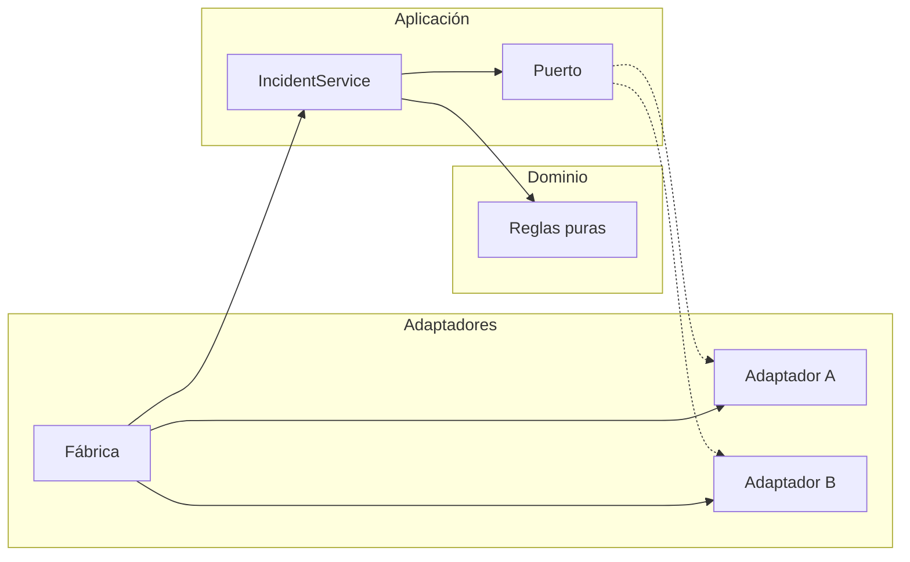

# Redacción de ADR en IncidentOps

## Cuándo usar esta skill

- Vas a proponer, redactar o revisar un ADR en `docs/adr/`.
- Debes comparar opciones de persistencia, topología de despliegue, fronteras de
  capas, contrato entre adaptadores o cualquier decisión estructural.
- Un hito cambia el stack, introduce un motor, un contenedor o un puerto nuevo y
  la Constitución exige un ADR antes de implementar.
- Detectas un ADR con dos decisiones, opciones de relleno, un diagrama de flujo
  algorítmico o requisitos copiados de `spec.md`.

No la uses para decisiones reversibles o locales (nombre de una variable, formato
de un log, orden de un `if`), para escribir escenarios BDD ni para trocear tareas.
Para eso existen `spec.md`, `plan.md` y la skill `bdd-acceptance`.

## 1. Fuentes de verdad y orden de lectura

1. `docs/adr/000-template.md`: estructura y metadatos obligatorios.
2. `docs/constitution.md`: principios, restricciones y gobernanza. Prevalece sobre
   los ADR; si el ADR la contradice, primero se enmienda la Constitución.
3. `docs/adr/[0-9][0-9][0-9]-*.md`: decisiones vigentes y números ocupados.
4. `docs/ROADMAP.md` y la especificación del hito: **solo** restricciones y
   contexto.
5. `spec.md` y `plan.md` del hito: se leen para no contradecirlos, nunca se copian.

La plantilla es la autoridad de formato. No la reproduzcas de memoria ni crees una
segunda plantilla dentro de la skill.

## 2. Una sola decisión arquitectónica por archivo

Un ADR registra **una** decisión estructural y difícil de revertir. Antes de
escribir, formula la decisión en una frase con un solo sujeto y un solo eje:

- Bien: «Adoptar un adaptador PostgreSQL sin ORM detrás del puerto de repositorio».
- Bien: «Ejecutar la API y PostgreSQL en una topología Compose de dos contenedores».
- Mal: «Adoptar PostgreSQL y contenedores»: son dos ejes independientes.

Pruebas rápidas:

- **Prueba del «y»**: si el título une dos sustantivos arquitectónicos con «y»
  («persistencia **y** runtime»), probablemente son dos ADR.
- **Prueba del eje**: si las alternativas de un bloque no compiten entre sí, hay
  más de una decisión.
- **Prueba de la consecuencia**: si algo se deduce de la decisión y no se eligió
  entre alternativas propias (por ejemplo, usar un volumen porque hay un
  contenedor de base de datos), es una consecuencia, no un ADR.
- **Prueba de reversibilidad**: si deshacerlo cuesta una tarde y no toca
  fronteras, contratos ni operación, no merece ADR.

Si aparecen dos decisiones, crea dos archivos consecutivos y cruza la referencia
en el contexto, sin duplicar alternativas.

## 3. Registro append-only y numeración

El directorio `docs/adr/` es un registro histórico, no un documento vivo.

1. Lista los ADR con `glob docs/adr/[0-9][0-9][0-9]-*.md`.
2. Usa el siguiente número libre, con tres dígitos (`007`, `008`). Nunca reutilices
   un número, aunque el ADR esté reemplazado.
3. Nombra el archivo `NNN-slug-en-kebab-case.md`, sin acentos ni eñes.
4. Titula `# ADR-NNN: Título corto de la decisión`.
5. No renumeres, no borres y no muevas ADR existentes. Los enlaces históricos
   (`Estado`, `Reemplaza a`, Constitución, ROADMAP) dependen de ellos.
6. El cuerpo de un ADR aceptado es inmutable. La única mutación permitida es la
   línea `Estado`, para añadir `Reemplazado por ADR-XXX` cuando otro ADR lo
   sustituya.
7. Para corregir o revertir una decisión, escribe un ADR nuevo con
   `Reemplaza a: ADR-XXX (total o parcial)`; no edites el anterior.
8. Si `Reemplaza a` cita un ADR que no existe en `docs/adr/`, no inventes su
   contenido: registra una nota de trazabilidad en §1, indica dónde vive la
   restricción vigente y pide decisión antes de cerrar.

## 4. Metadatos exactos

Copia el bloque de `docs/adr/000-template.md` y rellénalo:

```markdown
# ADR-NNN: Título corto

- **Estado**: Propuesto | Aceptado | Reemplazado por ADR-XXX
- **Fecha**: YYYY-MM-DD
- **Autor(es)**: Nombre del ingeniero o equipo
- **Reemplaza a**: *(ninguno)* | ADR-XXX (parcial o total)
```

Reglas:

- `Fecha` es la fecha de la decisión en ISO `YYYY-MM-DD`, no la del borrador.
- `Estado: Aceptado` solo si la decisión está aprobada; si no, `Propuesto`.
- `Reemplazado por` se expresa dentro de `Estado`, como fija la plantilla. No
  añadas campos nuevos ni una segunda línea de metadatos.
- Si el reemplazo es parcial, di **qué restricción** se sustituye.
- **Prohibido** `Componentes Afectados` con enlaces a archivos o líneas, listas de
  rutas y viñetas de comandos. La plantilla vigente ya no los admite.
- Los detalles tácticos (comandos, pasos de migración, nombres de pruebas) van en
  `plan.md` o `tasks.md`, no en el ADR.

## 5. Alternativas reales, sin relleno

Documenta **al menos dos** opciones arquitectónicas reales; tres o cuatro es
mejor. Todas deben evaluarse con las mismas restricciones y el mismo criterio.

Cada opción lleva:

- Nombre y una frase que describa el mecanismo.
- *Ventajas* concretas y verificables.
- *Desventajas* concretas: coste operativo, mantenimiento, migración, pruebas,
  acoplamiento o dependencia de proveedor.
- El motivo por el que se rechaza, si no es la elegida.

Incluye siempre el **statu quo** como una opción (no hacer el cambio) y evalúalo
con honestidad. Una opción que nadie defendería es un *strawman* y descalifica el
ADR.

Checklist anti-strawman:

- [ ] ¿Un ingeniero competente podría elegir cada opción con los datos del ADR?
- [ ] ¿Las opciones compiten por el mismo problema, no por problemas distintos?
- [ ] ¿Las desventajas de la opción elegida son reales y no cosméticas?
- [ ] ¿Las ventajas de las rechazadas están reconocidas?
- [ ] ¿Se evita «hacerlo mal a propósito» como única desventaja del rival?

Ejemplos de relleno prohibido: «Opción B: no hacer nada» sin análisis, «Opción C:
contratar a un equipo enorme», «Opción D: usar una tecnología que no existe».

## 6. Mermaid: opcional y solo estructural

El diagrama se incluye **solo si aclara** capas, límites o topología de
componentes. Si no aporta, se omite.

Permitido:

- `flowchart LR` o `flowchart TB` con `subgraph` por capa, frontera o contenedor.
- `C4Context` o `C4Container` para topología de despliegue.
- Nodos que representan componentes arquitectónicos (dominio, aplicación,
  adaptador, puerto, contenedor, volumen), no cada archivo.

Prohibido:

- `sequenceDiagram` para explicar un algoritmo o un flujo de petición paso a paso.
- Diagramas con rombos de decisión, etiquetas «si … entonces» o ramas `if/else`.
- `stateDiagram` de reglas de negocio (estados de un incidente, SLA, duplicados).
- Más de ~12 nodos, enlaces a archivos, comandos o código embebido.

Verifica que el bloque renderiza: `subgraph` cerrados con `end`, etiquetas entre
comillas si llevan `<br/>`, y ningún nodo huérfano.

Ejemplo estructural:



## 7. Prohibido duplicar `spec.md` y `plan.md`

El ADR justifica una decisión; no es una especificación ni un plan.

No copies:

- Requisitos funcionales (`FR-###`), criterios de aceptación, escenarios
  `Dado / Cuando / Entonces`, tablas de errores o de campos de `spec.md`.
- Fases, tareas (`T###`), árboles de archivos, comandos, pasos de migración o
  checklists de implementación de `plan.md` / `tasks.md`.

Sí puedes:

- Resumir en una frase la restricción que obliga a decidir.
- Referenciar «según `spec.md` §N» o «el plan del hito» sin reproducir su
  contenido.

Prueba de duplicación: si al borrar la frase el lector sigue entendiendo la
decisión y sus alternativas, la frase pertenecía a `spec.md` o `plan.md`.

## 8. Procedimiento

1. Lee las fuentes del §1 y localiza el hito en el ROADMAP.
2. Calcula el número libre con `glob`; si hay colisión, detente y repórtala.
3. Formula la decisión única y comprueba las cuatro pruebas del §2.
4. Enumera las alternativas reales, incluido el statu quo.
5. Elige una y justifica el criterio; reconoce lo que no resuelve.
6. Añade Mermaid solo si es estructural.
7. Escribe §4 (consecuencias) con positivas, negativas y trade-offs.
8. Aplica el checklist del §9 y corrige antes de guardar.
9. Guarda solo el archivo del ADR. Si la decisión cambia la Constitución, la
   enmienda se tramita aparte con `/speckit.constitution` antes o junto al ADR.
10. No actualices `AGENTS.md`, `README.md`, `plan.md` ni `CONTEXT_LOG.md` desde
    esta skill; eso pertenece al PR de implementación.

## 9. Checklist antes de cerrar

- [ ] Hay una sola decisión y el título no necesita «y» para unir dos ejes.
- [ ] El número es el siguiente libre y el nombre es `NNN-slug.md`.
- [ ] Metadatos exactos de la plantilla; sin `Componentes Afectados` ni comandos.
- [ ] `Reemplaza a` es concreto y, si es parcial, nombra la restricción.
- [ ] Al menos dos alternativas reales, con statu quo y desventajas honestas.
- [ ] La opción elegida se justifica contra las restricciones, no por gusto.
- [ ] Mermaid, si existe, es estructural y renderiza.
- [ ] No hay FR, BDD, tareas, rutas ni comandos copiados de `spec.md`/`plan.md`.
- [ ] Las consecuencias negativas y lo no resuelto están explícitos.
- [ ] El ADR no contradice la Constitución ni un ADR vigente.
- [ ] No se editó ningún ADR aceptado ni se renumeró el registro.

## 10. Referencias

- `docs/adr/000-template.md`
- `docs/constitution.md` (Principios III–VI y Gobernanza)
- `docs/adr/003-arquitectura-hexagonal.md`,
  `docs/adr/005-resumen-activos-hexagonal.md` y
  `docs/adr/006-ciclo-vida-duplicados-sla.md` como ejemplos del estilo vigente.
- `docs/ROADMAP.md` para el hito y su valor.
