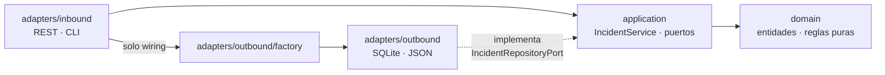

# Arquitectura hexagonal en IncidentOps

## Cuándo usar esta skill

- Vas a crear, mover o modificar código en `src/domain/`, `src/application/` o `src/adapters/`.
- Añades un puerto, un adaptador de entrada (REST, CLI, MCP) o un adaptador de salida.
- Revisas imports y sospechas que una capa está conociendo detalles de otra.
- Implementas una capacidad nueva que debe estar disponible en REST y CLI.
- Configuras o ejecutas la validación estática de fronteras con Ruff.

La fuente de verdad es `docs/constitution.md` §2 y `docs/adr/003-arquitectura-hexagonal.md`
(enmendado por `docs/adr/004-contrato-interfaces-h001.md`). Esta skill es la guía
operativa para aplicar esas reglas.

## 1. Regla de dependencia

La dirección permitida es una sola:

```text
adapters/inbound ──► application ──► domain
adapters/outbound ──► application (implementa sus puertos) ──► domain
```

- El dominio no importa nada de `src/` que no sea `src.domain`.
- La aplicación no importa adaptadores, frameworks ni detalles de transporte.
- Los adaptadores de entrada dependen del caso de uso, nunca de la persistencia concreta.
- Los adaptadores de salida implementan los puertos declarados por la aplicación.
- El dominio no tiene aristas salientes. Esa ausencia es deliberada.



## 2. Qué puede importar cada capa

### 2.1 `src/domain/` — núcleo puro

**Puede importar:**

- Biblioteca estándar determinista: `dataclasses`, `datetime` (tipos y aritmética),
  `enum`, `typing`, `re`, `difflib`, `unicodedata`, `collections`, `math`, `decimal`.
- Otros módulos del propio dominio, siempre con import absoluto:
  `from src.domain.severity import SeverityLevel`.

**No puede importar:**

- Frameworks o transporte: `fastapi`, `starlette`, `uvicorn`, `typer`, `click`,
  `pydantic`.
- Persistencia: `sqlite3`, `sqlalchemy`, `psycopg`, `psycopg2`.
- Serialización o CLI: `json`, `argparse`.
- Sistema operativo, red o procesos: `os`, `pathlib`, `io`, `socket`, `subprocess`,
  `requests`, `httpx`.
- Logging o `print`.
- Capas externas: `src.application`, `src.adapters`, `src.composition`, `src.models`,
  `src.sla_calculator`, `src.incident_repository`, `legacy`.

**Reglas adicionales:**

- Sin relojes implícitos: nada de `datetime.now()`, `time.sleep()` ni `random`.
  El tiempo de referencia entra como argumento o por `ClockPort`.
- Sin estado global mutable ni efectos observables fuera del valor de retorno.
- No redeclares entidades, objetos de valor ni reglas que ya viven aquí. Los DTOs de
  transporte se mapean en el borde.

### 2.2 `src/application/` — casos de uso y puertos

**Puede importar:**

- Biblioteca estándar.
- `src.domain.*`.
- Otros módulos de `src.application.*`.

**No puede importar:**

- Frameworks: `fastapi`, `starlette`, `uvicorn`, `typer`, `click`, `pydantic`.
- Persistencia: `sqlite3`, `sqlalchemy`, `psycopg`, `psycopg2`.
- Serialización o CLI: `json`, `argparse`.
- Adaptadores o composición: `src.adapters`, `src.composition`, `legacy`.
- Tipos legacy: `src.models`, `src.sla_calculator`, `src.incident_repository`.

**Responsabilidad:**

- `IncidentService` solo secuencia, transacciona y traduce entre puertos.
- Los puertos secundarios se declaran aquí con `typing.Protocol`, sin herencia
  obligatoria: `IncidentRepositoryPort`, `SlaPolicyPort`, `ClockPort`.
- No contiene reglas de negocio, SQL, DDL ni detalles de transporte.
- Los errores de entrada llevan un `code` estable (`ValidationError`) para que cada
  adaptador lo traduzca a su transporte.

Ejemplo de puerto (ajusta la firma a los tipos reales del dominio):

```python
# src/application/ports.py
from typing import Protocol, Sequence

from src.domain.incident import Incident


class IncidentRepositoryPort(Protocol):
    def save(self, incident: Incident) -> None: ...

    def list_active_by_component(self, component: str) -> Sequence[Incident]: ...

    def history(self, incident_id: str) -> Sequence[Incident]: ...
```

### 2.3 `src/adapters/inbound/` — REST, CLI y futuro MCP

**Puede importar:**

- Biblioteca estándar.
- El framework de su propio transporte: `fastapi`/`starlette`/`pydantic` para REST;
  `typer`/`click` para CLI.
- `src.application.services` (`IncidentService`, `ValidationError`).
- `src.domain` para mapear resultados a DTOs, sin redeclarar reglas.
- Otros módulos de `src.adapters.inbound.*`.
- `src.adapters.outbound.factory` para obtener el servicio ya cableado.

**No puede importar:**

- Drivers o librerías de base de datos: `sqlite3`, `sqlalchemy`, `psycopg`, `psycopg2`.
- Repositorios o adaptadores concretos: `src.adapters.outbound.sqlite`,
  `src.adapters.outbound.postgres`, `src.adapters.outbound.repositories`, etc.
- El repositorio legacy `src.incident_repository` ni los tipos legacy
  `src.models`/`src.sla_calculator`.
- `legacy/`.

**Reglas adicionales:**

- El adaptador valida la forma del transporte, mapea DTOs, formatea salida y errores.
  No clasifica, no calcula SLA, no detecta duplicados y no escribe SQL.
- Siempre delega en el mismo caso de uso. No construyas lógica paralela en el router
  ni en el comando de Typer.
- Obtén el servicio desde `src.adapters.outbound.factory`; no instancies
  repositorios concretos ni los pases a mano desde el borde. El factory es el único
  módulo de cableado que el inbound puede conocer.
- En H001 el factory aún no existe y `src/composition.py` cumple ese papel. Al
  introducir persistencia (H002/H003), mueve el ensamblaje al factory y deja
  `composition` como fachada de compatibilidad si hace falta; no dejes dos formas
  competidoras de construir el servicio.

Ejemplo de delegación:

```python
from src.adapters.outbound.factory import build_incident_service

service = build_incident_service()
resultado = service.triage_incident(incident_id, raw_text)
```

### 2.4 `src/adapters/outbound/` — persistencia y fuentes de datos

**Puede importar:**

- Biblioteca estándar y el driver concreto que implementa (`sqlite3` cuando exista
  persistencia, `psycopg` en H004).
- `src.application` para el puerto que implementa.
- `src.domain` para reconstruir entidades y aplicar reglas puras.
- Otros módulos de `src.adapters.outbound.*`.

**No puede importar:**

- `src.adapters.inbound` ni DTOs de FastAPI/Typer/Pydantic.
- Reglas de negocio duplicadas: usa las del dominio.
- `legacy/`.

**Reglas adicionales:**

- Implementa `IncidentRepositoryPort` de forma estructural. No hace falta heredar del
  `Protocol`; basta con respetar su firma. Si quieres dejar constancia, documéntalo en
  el docstring, no introduzcas herencia obligatoria.
- Todo el SQL, DDL, siembra de políticas, cursores y mapeo fila → entidad vive aquí.
- La deuda deliberada de `get_active_incidents_summary` (`SELECT *`, filtrado en
  Python y N+1) se queda confinada al adaptador SQLite. No la traslades al dominio ni
  la repliques en otros adaptadores.
- `src/adapters/outbound/factory.py` es el único punto que conoce las clases concretas
  y las inyecta en `IncidentService`. No es un repositorio: es la raíz de composición.

```python
# src/adapters/outbound/sqlite_repository.py
class SqliteIncidentRepository:
    """Implementa estructuralmente IncidentRepositoryPort."""

    def save(self, incident): ...
```

## 3. Paridad entre adaptadores primarios

REST y CLI son dos formas de invocar el mismo caso de uso, no dos implementaciones.

- Ambos llaman al mismo método de `IncidentService` (`triage_incident`, y en el futuro
  `register_incident`, `active_incidents_summary`, etc.).
- Ambos devuelven el mismo documento canónico para la misma entrada y el mismo estado.
- Ambos usan el mismo catálogo de códigos de error. Solo cambia el sobre del
  transporte: HTTP `application/problem+json` con 422; CLI por `stderr` con código de
  salida 2.
- Un adaptador nuevo (MCP) se limita a traducir su transporte al mismo caso de uso.
- Si una capacidad nueva no puede exponerse todavía en una interfaz, documéntalo como
  excepción explícita; no dejes una interfaz con lógica propia para compensar.

La paridad se prueba comparando la salida, no revisando el código a ojo. Referencia
actual: `tests/test_spec_001_triage.py`, prueba
`test_paridad_http_y_cli_sobre_los_reportes_de_muestra`, que compara el JSON de HTTP y
el de CLI para los mismos reportes. Al añadir una capacidad, añade su prueba de
paridad equivalente.

Diferencias permitidas: código de estado HTTP, cabeceras, formato de `stdout`/`stderr`,
flags de CLI y códigos de salida. Diferencias prohibidas: severidad, componente,
equipo, estado de SLA, `duplicate_group_key`, códigos de error o cualquier regla de
negocio.

## 4. Validación estática de fronteras con Ruff

Ruff no demuestra la arquitectura, pero convierte los imports prohibidos en errores
automáticos. La validación se ejecuta desde la raíz del repositorio:

```powershell
uv run ruff check src/
```

Para inspeccionar solo las reglas de fronteras:

```powershell
uv run ruff check src/ --select TID --output-format concise
```

### 4.1 Configuración raíz en `pyproject.toml`

```toml
[tool.ruff]
target-version = "py310"

[tool.ruff.lint]
select = ["E4", "E7", "E9", "F", "TID"]

[tool.ruff.lint.flake8-tidy-imports]
ban-relative-imports = "parents"
```

- `TID` habilita `TID251` (`banned-api`) y `TID252` (`ban-relative-imports`).
- `ban-relative-imports = "parents"` prohíbe `from ..` y superiores. Permite
  `from .`, pero la convención del proyecto es usar siempre imports absolutos
  (`from src...`), así que no uses relativos ni siquiera entre hermanos.
- No añadas reglas globales que rompan el código legacy. Las prohibiciones por capa
  viven en los `ruff.toml` jerárquicos.

### 4.2 `src/domain/ruff.toml`

```toml
extend = "../../pyproject.toml"

[lint.flake8-tidy-imports.banned-api]
"fastapi".msg = "El dominio no importa frameworks HTTP."
"starlette".msg = "El dominio no importa frameworks HTTP."
"uvicorn".msg = "El dominio no importa servidores HTTP."
"typer".msg = "El dominio no importa la CLI."
"click".msg = "El dominio no importa la CLI."
"pydantic".msg = "El dominio no depende de esquemas de transporte."
"sqlite3".msg = "El dominio no importa persistencia."
"sqlalchemy".msg = "El dominio no importa ORMs."
"psycopg".msg = "El dominio no importa drivers de BD."
"psycopg2".msg = "El dominio no importa drivers de BD."
"argparse".msg = "El dominio no importa la CLI."
"json".msg = "El dominio no serializa transporte."
"logging".msg = "El dominio no produce efectos de logging."
"io".msg = "El dominio no accede a archivos ni flujos."
"os".msg = "El dominio no accede al sistema operativo."
"pathlib".msg = "El dominio no accede al sistema de archivos."
"socket".msg = "El dominio no accede a la red."
"subprocess".msg = "El dominio no lanza procesos."
"requests".msg = "El dominio no accede a la red."
"httpx".msg = "El dominio no accede a la red."
"time".msg = "El dominio no usa relojes implícitos ni esperas."
"random".msg = "El dominio debe ser determinista."
"src.application".msg = "El dominio no conoce la capa de aplicación."
"src.adapters".msg = "El dominio no conoce adaptadores."
"src.composition".msg = "El dominio no conoce la raíz de composición."
"src.models".msg = "Legado: usa los tipos de src.domain."
"src.sla_calculator".msg = "Legado: usa las reglas de src.domain."
"src.incident_repository".msg = "Legado: la persistencia vive en adapters/outbound."
"legacy".msg = "legacy/ está congelado; no se importa."
```

### 4.3 `src/application/ruff.toml`

```toml
extend = "../../pyproject.toml"

[lint.flake8-tidy-imports.banned-api]
"fastapi".msg = "La aplicación no importa frameworks."
"starlette".msg = "La aplicación no importa frameworks."
"uvicorn".msg = "La aplicación no importa servidores HTTP."
"typer".msg = "La aplicación no importa la CLI."
"click".msg = "La aplicación no importa la CLI."
"pydantic".msg = "La aplicación no depende de esquemas de transporte."
"sqlite3".msg = "La aplicación no importa persistencia."
"sqlalchemy".msg = "La aplicación no importa ORMs."
"psycopg".msg = "La aplicación no importa drivers de BD."
"psycopg2".msg = "La aplicación no importa drivers de BD."
"argparse".msg = "La aplicación no importa la CLI."
"json".msg = "La aplicación no serializa; eso corresponde al adaptador."
"src.adapters".msg = "La aplicación no importa adaptadores."
"src.composition".msg = "La aplicación no conoce la raíz de composición."
"src.models".msg = "Legado: usa los tipos de src.domain."
"src.sla_calculator".msg = "Legado: usa las reglas de src.domain."
"src.incident_repository".msg = "Legado: la persistencia vive en adapters/outbound."
"legacy".msg = "legacy/ está congelado; no se importa."
```

### 4.4 `src/adapters/inbound/ruff.toml`

```toml
extend = "../../../pyproject.toml"

[lint.flake8-tidy-imports.banned-api]
"sqlite3".msg = "El inbound no importa drivers de BD; usa src.adapters.outbound.factory."
"sqlalchemy".msg = "El inbound no importa ORMs; usa src.adapters.outbound.factory."
"psycopg".msg = "El inbound no importa drivers de BD; usa src.adapters.outbound.factory."
"psycopg2".msg = "El inbound no importa drivers de BD; usa src.adapters.outbound.factory."
"src.adapters.outbound.sqlite".msg = "No importes repositorios concretos; usa src.adapters.outbound.factory."
"src.adapters.outbound.postgres".msg = "No importes repositorios concretos; usa src.adapters.outbound.factory."
"src.adapters.outbound.repositories".msg = "No importes repositorios concretos; usa src.adapters.outbound.factory."
"src.incident_repository".msg = "El inbound no importa el repositorio legacy."
"src.sla_calculator".msg = "El inbound no importa el cálculo legacy; delega en IncidentService."
"src.models".msg = "El inbound no usa tipos legacy; mapea desde src.domain."
"legacy".msg = "legacy/ está congelado; no se importa."
```

### 4.5 Reglas de funcionamiento de la configuración

- Ruff usa el archivo de configuración **más cercano** al archivo que analiza. Los
  `ruff.toml` hijos no se fusionan automáticamente con el padre: por eso cada uno
  lleva `extend` al `pyproject.toml` raíz. Si omites `extend`, perderás `select` y
  `ban-relative-imports` en esa capa.
- En un `ruff.toml` las tablas son `[lint...]`; en `pyproject.toml` son
  `[tool.ruff.lint...]`. No mezcles las sintaxis.
- Las rutas de `extend` son relativas al archivo que las declara:
  - `src/domain/ruff.toml` → `../../pyproject.toml`
  - `src/application/ruff.toml` → `../../pyproject.toml`
  - `src/adapters/inbound/ruff.toml` → `../../../pyproject.toml`
- `TID251` compara el módulo y sus subárboles: prohibir
  `src.adapters.outbound.sqlite` también bloquea
  `from src.adapters.outbound.sqlite.repo import ...`.
- `TID251` no admite excepciones dentro de un prefijo prohibido. Por eso no prohíbas
  `src.adapters.outbound` entero en inbound: bloquearías también `factory`. Prohíbe
  los módulos concretos y mantén `factory.py` como única entrada permitida.
- `TID251` solo ve sentencias `import`/`from`. No detecta `importlib.import_module`,
  `__import__`, imports construidos con cadenas ni dependencias transitivas. Esos
  casos se revisan en el PR.
- `TID252` con `"parents"` no bloquea `from . import ...`. La convención del
  repositorio exige imports absolutos, así que un relativo entre hermanos también se
  rechaza en revisión.
- Opcional, no exigido por esta skill: un `src/adapters/outbound/ruff.toml` que
  prohíba `src.adapters.inbound`, `fastapi` y `typer` refuerza la dirección de salida.

### 4.6 Verificación

1. Ejecuta `uv run ruff check src/`. Debe terminar sin errores.
2. Si añadiste una frontera nueva, compruébala con un import prohibido temporal en un
   archivo de esa capa: Ruff debe reportar `TID251`. Elimínalo después.
3. Ejecuta `uv run pytest`. La paridad REST/CLI y las reglas de dominio deben seguir
   pasando.
4. No desactives una regla con `# noqa` para hacer pasar el lint sin corregir el
   diseño. Si de verdad hace falta una excepción, documéntala y justifícala en el PR.

## 5. Checklist antes de cerrar un cambio

- [ ] `src/domain/` no importa frameworks, persistencia, CLI, serialización, sistema
      operativo, red ni capas externas.
- [ ] `src/application/` solo importa biblioteca estándar y `src.domain`.
- [ ] Los puertos nuevos son `typing.Protocol` y viven en la aplicación.
- [ ] `src/adapters/inbound/` delega en `IncidentService` y no importa drivers ni
      repositorios concretos.
- [ ] El inbound obtiene el servicio desde `src.adapters.outbound.factory` (o desde la
      raíz de composición mientras el factory no exista).
- [ ] `src/adapters/outbound/` implementa `IncidentRepositoryPort` y no importa el
      inbound.
- [ ] REST y CLI invocan el mismo caso de uso y tienen prueba de paridad.
- [ ] No hay tipos ni reglas de negocio duplicados fuera de `src/domain/`.
- [ ] `uv run ruff check src/` pasa.
- [ ] `uv run pytest` pasa.
- [ ] `AGENTS.md` y la documentación afectada se actualizan en el mismo PR.

## 6. Estado actual del repositorio (no lo confundas con el objetivo)

- H001 ya tiene dominio, aplicación y adaptadores inbound (FastAPI y Typer). No hay
  `src/adapters/outbound/`, ni `IncidentRepositoryPort`, ni factory: la clasificación
  es pura y `src/composition.py` construye `IncidentService`.
- `pyproject.toml` todavía no contiene `[tool.ruff]` y no existen los `ruff.toml`
  jerárquicos. Al aplicar esta skill, créalos con el contenido de §4; sin `select`,
  Ruff 0.17.6 aplica un conjunto amplio por defecto y `uv run ruff check src/` falla
  por reglas que el proyecto no ha adoptado.
- `src/models.py`, `src/sla_calculator.py` y `src/incident_repository.py` son legado
  transitorio. No los importes desde las capas hexagonales ni los uses como fuente de
  verdad. `legacy/triage_rules.py` está congelado y nunca se importa.
- La deuda N+1 de `get_active_incidents_summary` es intencional: no la corrijas salvo
  que el reto sea exactamente ese refactor.
