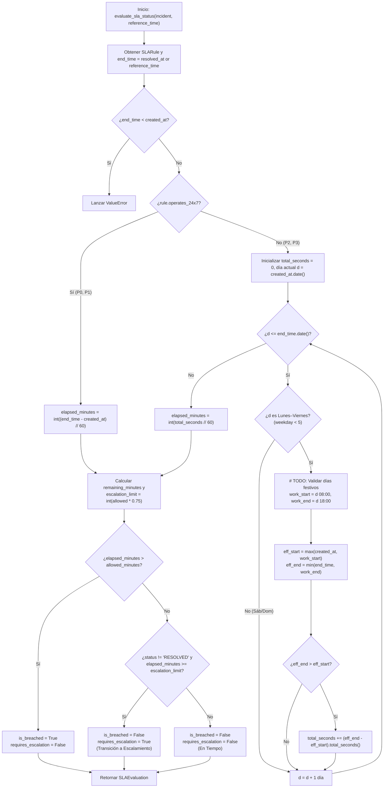

# ADR-002: Cálculo de SLA en Horario Hábil mediante Intersección de Bloques Diarios

- **Estado**: Aceptado
- **Fecha**: 2026-11-17
- **Autor(es)**: Equipo de Ingeniería IncidentOps
- **Componentes Afectados**: [`src/sla_calculator.py`, `src/models.py`]

---

## 1. Contexto y Problema

En la plataforma **IncidentOps**, la función `evaluate_sla_status` evalúa el tiempo transcurrido de un incidente contra el acuerdo de nivel de servicio (`SLARule`) configurado en `SLA_POLICY_TABLE`. Actualmente, el cálculo computa únicamente la diferencia absoluta de tiempo entre `created_at` y `end_time` (`resolved_at` o `reference_time`), asumiendo una operación continua de 24 horas los 7 días de la semana.

Sin embargo, las reglas de negocio establecen que mientras las severidades críticas (`P0` y `P1`) operan bajo modalidad `24x7` (`operates_24x7=True`), las severidades moderadas y bajas (`P2` con 480 min y `P3` con 1440 min) operan exclusivamente dentro del **horario hábil de lunes a viernes de 08:00 a 18:00** (`operates_24x7=False`).

El código actual presenta las siguientes limitaciones y casos borde críticos:
- **Falsos incumplimientos (`is_breached`) y escalamientos prematuros (`requires_escalation`)**: Un incidente `P2` creado el viernes a las 17:30 aparece como incumplido el lunes a las 08:30 al contabilizar las horas nocturnas y del fin de semana.
- **Incidentes creados fuera de ventana laboral**: Incidentes reportados antes de las 08:00, después de las 18:00, o durante sábados y domingos no deben acumular minutos de SLA hasta el inicio efectivo del siguiente bloque hábil.
- **Restricciones técnicas**: La solución debe ser determinista, libre de dependencias externas (usando únicamente la biblioteca estándar `datetime` de Python) y mantener una complejidad temporal acotada para incidentes abiertos durante múltiples semanas.

---

## 2. Opciones Consideradas

1. **Opción A — Iteración minuto a minuto**:
   - *Ventajas*: Lógica intuitiva; fácil de validar si cada minuto individual cae dentro de `08:00–18:00` en días hábiles.
   - *Desventajas*: Rendimiento deficiente ($O(N)$ respecto a los minutos totales transcurridos). Un incidente abierto durante varias semanas obliga a iterar decenas de miles de veces por cada llamada a `evaluate_sla_status`, penalizando consultas masivas en `incident_repository.py`.

2. **Opción B — Cálculo matemático directo $O(1)$**:
   - *Ventajas*: Tiempo de ejecución constante independientemente de la duración del incidente.
   - *Desventajas*: Alta complejidad algorítmica para ajustar los extremos parciales del primer y último día, manejar incidentes creados y cerrados fuera de horario o en fines de semana, y alta propensión a errores *off-by-one* con baja legibilidad para mantenimiento.

3. **Opción C — Iteración por bloques de días con intersección de ventana laboral (Elegida)**:
   - *Ventajas*: Complejidad lineal respecto al número de días calendario ($O(D)$), garantizando tiempos de respuesta sub-milisegundo incluso en incidentes de meses. Resuelve de forma limpia y determinista los fines de semana, horas nocturnas y creación fuera de horario mediante intersección de intervalos `[max(inicio_intervalo, 08:00), min(fin_intervalo, 18:00)]`.
   - *Desventajas*: Requiere un bucle diario (aunque mínimo) y deja la gestión de días festivos diferida como deuda técnica explícita.

---

## 3. Decisión Arquitectónica

Se adopta la **Opción C (Iteración por bloques de días con intersección de ventana laboral)** para calcular los minutos hábiles efectivos cuando `rule.operates_24x7` es `False`.

### Diseño de la Solución
1. **Bifurcación por modalidad**: Si `rule.operates_24x7` es `True` (`P0`, `P1`), se conserva el cálculo directo `(end_time - created_at).total_seconds() // 60`.
2. **Intersección diaria (`08:00` – `18:00`)**: Si `rule.operates_24x7` es `False` (`P2`, `P3`), se recorre cada fecha calendario `d` desde `created_at.date()` hasta `end_time.date()`:
   - Si `d.weekday() >= 5` (sábado o domingo), el día aporta `0` segundos.
   - Para días hábiles (`0..4`), se define la ventana laboral `[work_start, work_end]` (`08:00` a `18:00` de ese día) y se calcula la intersección efectiva:
     - `effective_start = max(created_at, work_start)`
     - `effective_end = min(end_time, work_end)`
     - Si `effective_end > effective_start`, se acumula `(effective_end - effective_start).total_seconds()`.
   - Este enfoque maneja automáticamente incidentes creados antes de las 08:00 (donde `effective_start` se ajusta a `08:00`), después de las 18:00 (donde `effective_end <= effective_start` y aporta `0`), o en fines de semana.
3. **Deuda técnica controlada**: Se documentará explícitamente mediante un comentario `# TODO` la exclusión de calendarios de días festivos locales para una futura iteración.
4. **Evaluación de estado y escalamiento**: Con `elapsed_minutes` calculado, se determinan `remaining_minutes`, `is_breached` (`elapsed_minutes > max_resolution_minutes`) y `requires_escalation` (`status != "RESOLVED"`, `not is_breached` y `elapsed_minutes >= int(max_resolution_minutes * escalation_threshold_ratio)`).

---

## 4. Consecuencias e Impacto
- **Positivas**: 
    - Precisión del negocio: Elimina falsos positivos de incumplimiento y escalamientos innecesarios fuera de horario laboral y fines de semana para incidentes P2 y P3.

    - Rendimiento predecible: Al iterar por día en lugar de por minuto, un incidente abierto durante 30 días requiere exactamente 30 iteraciones en lugar de 43,200, manteniendo cero dependencias externas.

    - Simplicidad en casos borde: La intersección de intervalos resuelve sin ramificaciones especiales los incidentes creados en sábado/domingo, en madrugada o resueltos fuera de jornada.

- **Negativas / Trade-offs**: 
    - Días festivos no contemplados: Al asumir todos los lunes a viernes como hábiles (deuda técnica documentada con # TODO), los incidentes que atraviesen días feriados seguirán contabilizando esas jornadas hasta que se integre un proveedor de calendario festivo.

    - Consistencia de zonas horarias: Se asume que incident.created_at, incident.resolved_at y reference_time comparten la misma zona horaria (o son naive consistentes) para construir work_start y work_end sin errores de comparación offset-naive vs offset-aware.
- **Verificación**:
    -  Pruebas unitarias en tests/test_sla_calculator.py cubriendo:

        1. Incidentes P0/P1 ignorando restricciones horarias (operates_24x7=True).

        2. Incidentes P2 creados un viernes a las 17:00 y evaluados el lunes a las 09:00 (verificando exactamente 120 minutos transcurridos).

        3. Incidentes creados el sábado o domingo y cerrados antes del lunes a las 08:00 (0 minutos transcurridos).

        4. Incidentes creados antes de las 08:00 o después de las 18:00 en días hábiles.

        5. Transición exacta a requires_escalation=True al alcanzar el 75% del SLA hábil (360 min en P2, 1080 min en P3) y desactivación al superar el 100% (is_breached=True) o pasar a RESOLVED.