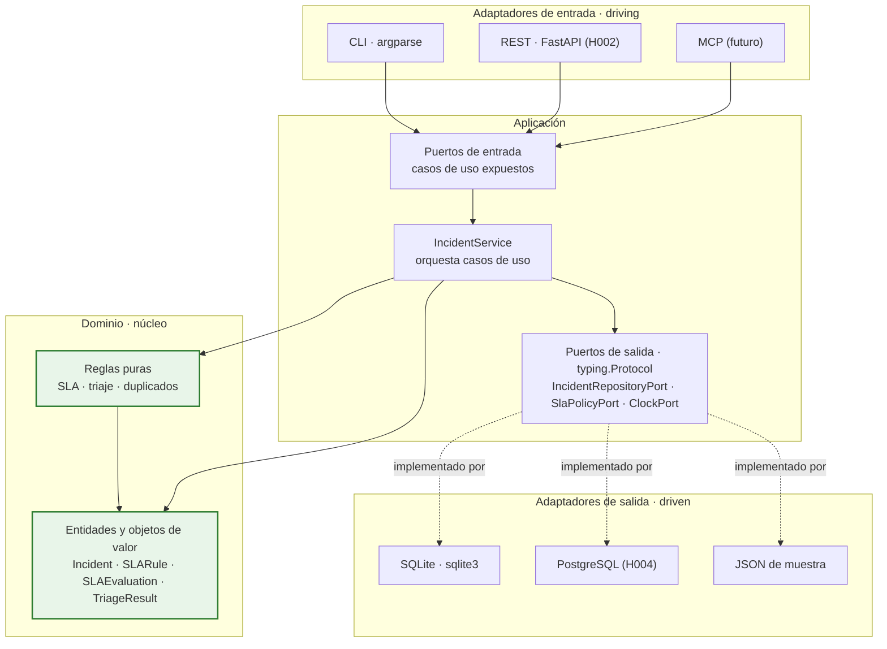

# ADR-003: Adopción de Arquitectura Hexagonal (Puertos y Adaptadores) para IncidentOps

- **Estado**: Aceptado · enmendado por ADR-009 (CLI con Typer y REST desde H001)
- **Fecha**: 2026-11-22
- **Autor(es)**: Equipo de Ingeniería IncidentOps
- **Reemplaza a**: *(ninguno)*

---

## 1. Contexto y Problema

IncidentOps debe entregar las mismas capacidades operativas a través de interfaces distintas y sobre mecanismos de persistencia que van a cambiar. El ROADMAP fija ese recorrido: H001 exige que un mismo reporte produzca la misma clasificación y enrutamiento en web y terminal; H002 exige el mismo resumen de incidentes activos en ambas interfaces; H003 añade registro persistente, detección de duplicados y auditoría de SLA; H004 exige base de datos relacional dedicada y ejecución en contenedores. La decisión estructural pendiente es **dónde viven las fronteras entre reglas de negocio, casos de uso y mecanismos de entrada/salida**, porque de ella depende que esas capacidades se sumen sin reescribir el núcleo cada vez.

El código actual resuelve cada capacidad dentro de un módulo que mezcla niveles:

- `src/triage_rules.py` contiene las reglas de clasificación y, en el mismo archivo, calcula rutas de archivo en tiempo de importación (`PROJECT_ROOT`, `SAMPLE_DATA_PATH`), lee el JSON de muestra y escribe trazas de seguimiento en `stdout` (`[CLASSIFY]`, `[BATCH]`, `[DUPLICATE_DETECTED]`).
- `src/sla_calculator.py` contiene la política y el cálculo de SLA (ADR-002) junto con su propia demostración `main()`.
- `src/incident_repository.py` mezcla el caso de uso de resumen con el mecanismo de persistencia: abre `sqlite3` en el constructor, ejecuta DDL en `_init_schema`, siembra `sla_policies` desde la tabla de dominio y reconstruye entidades a partir de `sqlite3.Row` dentro del bucle de consulta.
- La capa de entrada es implícita: cada módulo se ejecuta con `python -m` y `argparse`, de modo que la interfaz de terminal está incrustada en el mismo archivo que las reglas.
- El dominio está duplicado: `src/models.py` y `src/sla_calculator.py` declaran el mismo conjunto de tipos con los mismos nombres, y `IncidentStatus` diverge entre ambos (`models.py` omite `IN_PROGRESS`, que el repositorio persiste y consulta).

Restricciones vigentes:

- Python 3.10 y biblioteca estándar; hoy solo `tiktoken` como dependencia, sin framework web, ORM ni contenedor de inyección.
- `[tool.uv] package = false` e imports absolutos (`from src...`) resueltos únicamente desde la raíz del repositorio.
- Determinismo del negocio: invariantes de ADR-002 (P0/P1 24x7, P2/P3 con ventana hábil, escalamiento al 75 %, incumplimiento estricto `elapsed > allowed`) y reglas de triaje (procesamiento por `created_at`, duplicados con similitud ≥ 0.75 dentro de la ventana de cada severidad).
- La deuda de rendimiento de `get_active_incidents_summary` (`SELECT *`, filtrado en Python y consultas N+1) es un ejercicio deliberado de la Fase 2 y queda fuera del alcance de esta decisión.
- No hay suite de pruebas, linter ni verificador de tipos configurados, así que una reestructuración amplia no tiene red de seguridad automatizada.

La decisión es estructural y difícil de revertir: una vez fijadas las fronteras, cada capacidad nueva se implementa como adaptador, y volver al acoplamiento actual exigiría reescribir todos los puntos de entrada y los casos de uso a la vez.

---

## 2. Opciones Consideradas

1. **Opción A — Arquitectura en capas tradicional acoplada al framework (FastAPI + SQLite)**:
   - *Ventajas*: Pocas indirecciones y curva de entrada baja. FastAPI genera el contrato OpenAPI y valida payloads con Pydantic sin trabajo adicional. El camino "router → servicio → repositorio" es el idiomático del ecosistema, con documentación abundante, y para un equipo pequeño el coste de coordinación es mínimo.
   - *Desventajas*: El framework pasa a ser el centro. Los modelos de dominio tienden a ser los esquemas Pydantic del router, de modo que el núcleo importa FastAPI y queda atado a su versión y a su ciclo de vida. El acceso a datos se filtra hacia los servicios (`sqlite3`, SQL, filas), así que H004 (PostgreSQL dedicado) obliga a tocar los casos de uso. CLI y el futuro MCP no pueden reutilizar el caso de uso sin arrastrar la capa HTTP o duplicar la orquestación. Las pruebas requieren levantar la aplicación y una base real, coste que hoy ninguna suite absorbe.

2. **Opción B — Arquitectura hexagonal con puertos y adaptadores (`typing.Protocol` + `IncidentService`)**:
   - *Ventajas*: La dirección de dependencia se invierte y queda explícita: el dominio no conoce `sqlite3`, `fastapi`, `argparse` ni `json`, y los adaptadores dependen de la aplicación, nunca al revés. Un mismo caso de uso en `IncidentService` sirve a CLI, REST y MCP, que es exactamente el "misma clasificación y mismo resumen en ambas interfaces" de H001 y H002. La persistencia queda detrás de un puerto, por lo que H004 se resuelve sustituyendo un adaptador. Los puertos como `typing.Protocol` permiten reemplazar SQLite por dobles en memoria sin herencia ni dependencias externas. El dominio pasa a ser la única fuente de verdad de los tipos y elimina la duplicación `models.py` / `sla_calculator.py`.
   - *Desventajas*: Más archivos, más indirecciones y más mapeo (fila ↔ entidad ↔ DTO de transporte) para un código que hoy son cinco módulos. `typing.Protocol` es estructural y no se verifica en tiempo de ejecución: nada impide que un adaptador se importe desde el dominio salvo la disciplina de revisión, y un verificador como `import-linter` sería una dependencia nueva. Los puertos para REST y MCP son especulativos hasta que H002 y H004 existan, con riesgo de abstracción prematura.

---

## 3. Decisión Arquitectónica

Se adopta la **Opción B**: IncidentOps se organiza como arquitectura hexagonal, con el dominio en el centro y toda entrada/salida como adaptador reemplazable. La decisión se concreta en cinco reglas estructurales.

**a) Núcleo de dominio (`src/domain/`).** Entidades y objetos de valor (`Incident`, `SLARule`, `SLAEvaluation`, `TriageResult`, `SeverityLevel`, `IncidentStatus` unificado con `IN_PROGRESS`) y reglas puras: cálculo de SLA de ADR-002, clasificación por impacto y detección de duplicados. Sin `sqlite3`, `json`, `argparse`, `fastapi` ni `print`, y sin relojes implícitos: el tiempo de referencia entra como argumento. Es la única definición de los tipos de negocio y sustituye la duplicación actual entre `src/models.py` y `src/sla_calculator.py`.

**b) Capa de aplicación (`src/application/`).** `IncidentService` orquesta los casos de uso (triaje de un reporte y de un lote, registro, resumen de activos, reevaluación de SLA) y declara los puertos. No contiene reglas de negocio ni detalles de transporte: solo secuencia, transacción y traducción entre puertos.

**c) Puertos con `typing.Protocol`.** Los contratos se declaran como `Protocol` de la biblioteca estándar, sin herencia obligatoria ni dependencias: `IncidentRepositoryPort` (guardar, listar activos por componente, recuperar historial), `SlaPolicyPort` (leer la política vigente) y `ClockPort` (tiempo de referencia inyectable, para determinismo). Los puertos de entrada son los casos de uso que `IncidentService` expone. Se elige `Protocol` sobre `abc.ABC` para que los adaptadores no hereden de la aplicación y el acoplamiento sea puramente estructural.

**d) Adaptadores (`src/adapters/`).** `inbound/` traduce transporte a caso de uso: CLI hoy (`argparse`, `__main__` y formateo de salida), REST con FastAPI en H002 y MCP cuando se requiera. `outbound/` implementa los puertos: persistencia SQLite hoy, PostgreSQL en H004 y lectura del JSON de muestra como adaptador de origen de datos. El SQL, el DDL, la siembra de políticas y el mapeo desde `sqlite3.Row` viven exclusivamente aquí.

**e) Raíz de composición y regla de dependencia.** Un único punto de ensamblaje construye los adaptadores concretos y los inyecta en `IncidentService`; es el único lugar que conoce clases concretas. La regla es unidireccional: `adapters → application → domain`, y el dominio no importa nada de `src`.

El diagrama fija topología y fronteras: las flechas continuas son dependencias de compilación y las punteadas indican implementación de un puerto. El dominio no tiene aristas salientes; esa ausencia es la decisión.

---

## 4. Consecuencias y Trade-offs

- **Positivas**:
  - **Desacoplamiento del mecanismo**: el dominio deja de depender de `sqlite3`, `argparse`, `json` y de cualquier framework web; las reglas de ADR-002 y de triaje quedan evaluables sin base de datos ni `stdout`.
  - **Multi-interfaz por construcción**: H001 y H002 dejan de depender de duplicar lógica, porque CLI, REST y MCP son adaptadores del mismo caso de uso.
  - **Portabilidad de persistencia**: H004 se convierte en un adaptador nuevo más un cambio en la raíz de composición, sin tocar reglas ni casos de uso.
  - **Testabilidad y determinismo**: los puertos admiten dobles en memoria y `ClockPort` elimina el `datetime.now()` implícito del triaje.
  - **Una sola fuente de verdad de tipos**: desaparece la duplicación `models.py` / `sla_calculator.py` y la divergencia de `IncidentStatus`.
  - **Mantenibilidad acotada**: el N+1 deliberado queda confinado al adaptador SQLite, de modo que el refactor de Fase 2 no arrastra el dominio.

- **Negativas / Trade-offs**:
  - **Complejidad estructural**: más módulos, más indirecciones y mapeos explícitos entre fila, entidad y DTO para un sistema que hoy son cinco archivos; el coste se paga antes de que REST y PostgreSQL existan.
  - **Puertos especulativos**: REST y MCP aún no existen (H002/H004), así que parte del contrato se diseña por anticipado y puede requerir ajustes.
  - **Verificación débil**: `typing.Protocol` no impone la regla de dependencia en tiempo de ejecución; sin `import-linter` (dependencia nueva) la frontera se sostiene por revisión de código.
  - **Migración transversal**: los puntos de entrada cambian de `python -m src.triage_rules`, `src.sla_calculator` y `src.incident_repository` a los adaptadores CLI, por lo que `AGENTS.md` y `README.md` deben actualizarse en el mismo cambio; una migración a medias deja dos formas competidoras de invocar el sistema.
  - **Sin red de seguridad**: no hay suite de pruebas ni verificador de tipos, así que la equivalencia funcional debe comprobarse ejecutando los mismos escenarios de demostración antes y después.
  - **No resuelve rendimiento ni esquema**: `SELECT *`, filtrado en Python y N+1 siguen siendo deuda de Fase 2, y el esquema sigue siendo responsabilidad del adaptador.

---

## 5. Nota de enmienda (ADR-009)

Este ADR describía la CLI con `argparse` y situaba el adaptador REST en H002. La
Constitución §2.3 y §3.1 fijan Typer y FastAPI + Pydantic v2, y H001 exige ambas
interfaces. `ADR-009` concreta el contrato de interfaces y prevalece en esos dos
puntos; la topología y la regla de dependencia de este ADR siguen vigentes.
