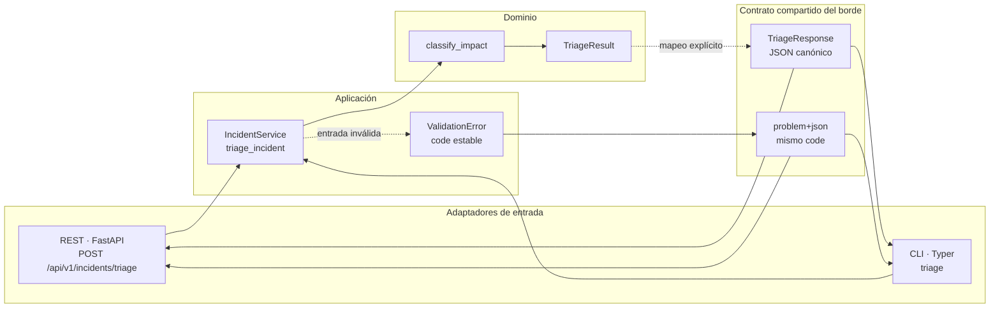

# ADR-004: Contrato único de interfaces para el triaje (H001)

- **Estado**: Aceptado
- **Fecha**: 2026-11-22
- **Autor(es)**: Equipo de Ingeniería IncidentOps
- **Reemplaza a**: *(ninguno)*
- **Enmienda a**: `ADR-003` (CLI con Typer y REST desde H001)

---

## 1. Contexto y Problema

H001 exige que un mismo reporte produzca la misma clasificación y el mismo
enrutamiento en web y terminal. `ADR-003` fijó la topología hexagonal, pero dejó dos
supuestos que el hito ya no puede sostener: situaba REST en H002 y describía la CLI
con `argparse`, mientras la Constitución §2.3 y §3.1 exigen FastAPI + Pydantic v2 y
Typer, y H001 pide ambas interfaces ahora.

La decisión pendiente no es la topología, ya resuelta, sino **cómo se define el
contrato de salida** para que dos adaptadores distintos no diverjan: qué campos
viajan, con qué nombres, con qué formato de error y qué parte del resultado es
contractual. Si cada adaptador formatea a su manera, la paridad de H001 se convierte
en una coincidencia accidental que ninguna prueba puede sostener.

Restricciones vigentes:

- Operación stateless: sin persistencia, sin reloj y sin repositorio en H001.
- Tipos de dominio únicos en `src/domain/`; los DTOs de transporte se mapean de forma
  explícita en el borde (Constitución §1.1).
- La detección de duplicados pertenece a H003, pero `TriageResult` ya contempla
  `duplicate_group_key`.
- La CLI debe servir a soporte en terminal y a la vez permitir una comparación
  automática con HTTP.

---

## 2. Opciones Consideradas

1. **Opción A — Contrato canónico compartido con mapeo explícito**:
   - *Ventajas*: Un solo documento JSON define la salida de ambas interfaces; la
     paridad se verifica comparando objetos, no reconstruyendo formatos. El error
     tiene un único `code` estable reutilizado por REST (`problem+json`) y por CLI
     (`stderr`). El DTO de transporte se mapea desde `TriageResult`, de modo que el
     dominio no se convierte en esquema HTTP y puede evolucionar sin arrastrar el
     framework.
   - *Desventajas*: Más mapeo y un módulo compartido entre adaptadores; la CLI pierde
     la tabla legible por humanos y el error HTTP exige un manejador propio en lugar
     del 422 por defecto de FastAPI.

2. **Opción B — Formato propio por adaptador**:
   - *Ventajas*: La CLI puede mostrar una tabla cómoda y REST puede apoyarse en el
     `{"detail": ...}` nativo de FastAPI; menos código y menos acoplamiento entre
     adaptadores.
   - *Desventajas*: La paridad de H001 queda sin contrato verificable; cada adaptador
     decide nombres y códigos, y cualquier cambio de campo obliga a sincronizar dos
     formatos a mano. Los errores dejan de ser comparables entre interfaces.

3. **Opción C — Exponer los tipos de dominio como esquema Pydantic**:
   - *Ventajas*: Cero mapeo y generación inmediata de OpenAPI.
   - *Desventajas*: El dominio pasa a depender de Pydantic o se duplica; cualquier
     cambio interno del núcleo se filtra al contrato público y viceversa. Viola la
     regla de dependencia y la prohibición de redeclarar tipos.

---

## 3. Decisión Arquitectónica

Se adopta la **Opción A**. El contrato se concreta en cinco reglas.

**a) Un único caso de uso.** `IncidentService.triage_incident(incident_id, raw_text)`
es el punto de entrada para REST y CLI. En H001 no declara puertos de salida: la
clasificación es pura y no depende de reloj ni de persistencia.

**b) Un único documento de salida.** Ambas interfaces devuelven el mismo objeto con
`incident_id`, `severity`, `component`, `recommended_team`, `rationale` y
`duplicate_group_key`. `rationale` es texto libre y no contractual.
`duplicate_group_key` queda reservado y siempre `null` hasta H003, para no cambiar la
forma de la respuesta al añadir duplicados.

**c) Un único contrato de error.** Los fallos de entrada usan códigos estables
(`TRIAGE_ID_VACIO`, `TRIAGE_TEXTO_VACIO`, `TRIAGE_ID_DEMASIADO_LARGO`,
`TRIAGE_TEXTO_DEMASIADO_LARGO`) y el mismo documento RFC 9457: cuerpo
`application/problem+json` en HTTP y `stderr` en CLI. El 422 por defecto de FastAPI se
sustituye por un manejador propio.

**d) Alcance mínimo del transporte.** Solo triaje individual. El lote y la detección
de duplicados se posponen a H003, porque sin persistencia el historial tendría que
viajar en la petición y eso convertiría el contrato de H001 en el de H003.

**e) La CLI habla JSON.** Sin tabla por defecto: `--raw-text` en línea, `--raw-text -`
para `stdin` y `--file` para un único reporte. Códigos de salida 0 éxito, 2 entrada
inválida y 1 error inesperado.

---

## 4. Consecuencias y Trade-offs

- **Positivas**:
  - La paridad de H001 es verificable con una prueba que compara el JSON de HTTP y el
    de CLI para los mismos reportes.
  - El dominio no depende de FastAPI ni de Typer, y el contrato público no depende de
    la forma interna de `TriageResult`.
  - Un solo catálogo de códigos de error evita divergencias entre interfaces.
  - `duplicate_group_key` reservado permite que H003 añada duplicados sin romper el
    contrato de H001.
- **Negativas / Trade-offs**:
  - La CLI deja de ofrecer salida tabular; quien la quiera deberá pipear a otra
    herramienta.
  - El manejador de errores propio sustituye el comportamiento nativo de FastAPI y hay
    que mantenerlo.
  - `IncidentService` es un pass-through en H001: se acepta porque H003 le añadirá
    registro y duplicados, pero hoy no aporta lógica propia.
  - Sin lote ni historial, las reglas de duplicados de §1.4 quedan sin ejercitar hasta
    H003.
