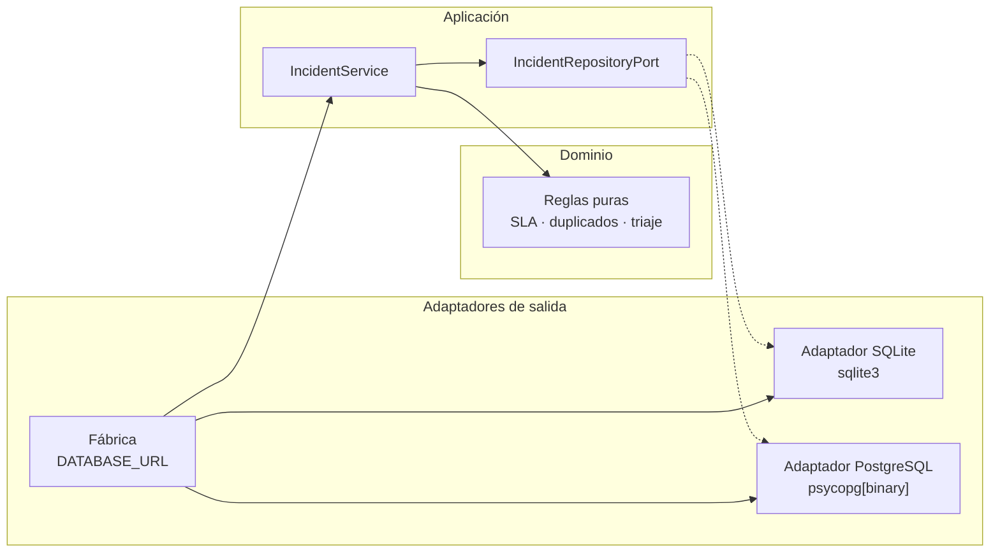

# ADR-004: Persistencia PostgreSQL y runtime de contenedores

- **Estado**: Aceptado
- **Fecha**: 2026-11-23
- **Autor(es)**: Equipo de Ingeniería IncidentOps
- **Reemplaza a**: `ADR-001` (parcialmente: restricción «solo `sqlite3` sin dependencias externas»)

---

## 1. Contexto y Problema

H003 consolidó la persistencia en SQLite embebido: un archivo local, una conexión
por repositorio y un cerrojo de acceso por proceso. Ese diseño sostiene el
triaje, el resumen y el ciclo de vida con un coste operativo mínimo, pero deja
tres límites estructurales: un solo escritor efectivo, coordinación limitada al
proceso que abre el archivo y ausencia de un servidor de base de datos dedicado
con el que verificar conectividad real. H004 exige una base relacional dedicada
sin renunciar al camino local sin infraestructura que mantiene rápidos el
desarrollo y las pruebas.

La decisión pendiente no es si añadir PostgreSQL, sino **cómo incorporarlo sin
romper el puerto `IncidentRepositoryPort`, sin duplicar reglas en los adaptadores
y sin convertir un ORM en el centro del sistema**. Las restricciones vigentes son
la pureza del dominio, la dependencia unidireccional `adapters → application →
domain`, la raíz de composición única, la paridad REST/CLI y la semántica
temporal naive ya fijada por ADR-002 y ADR-006.

**Nota de trazabilidad**: `ADR-001` no está versionado en `docs/adr/`. La
restricción que esta decisión reemplaza parcialmente («solo `sqlite3` sin
dependencias externas») se conserva en la Constitución §V; el reemplazo se
entiende sobre ese texto y no sobre un documento ausente.

---

## 2. Opciones Consideradas

1. **Opción A — SQLAlchemy 2.x con Alembic**:
   - *Ventajas*: una sola abstracción de dialecto para ambos motores, mapeo
     declarativo y un sistema de migraciones maduro. Reduce el SQL escrito a mano
     y facilita incorporar cambios de esquema versionados.
   - *Desventajas*: el ORM y su dialecto pasan a ser el centro del diseño; las
     entidades de dominio tienden a duplicarse o acoplarse a los modelos de tabla.
     El mapeo declarativo tiende a ocultar el SQL y el plan de ejecución de los
     índices, no elimina las diferencias reales entre motores y añade dos
     dependencias grandes más un ciclo de migraciones que este servicio no
     necesita todavía. Contradice la restricción de «sin ORM» y dificulta auditar
     la frontera hexagonal.

2. **Opción B — Adaptador PostgreSQL dedicado con `psycopg[binary]` y SQL explícito**:
   - *Ventajas*: el puerto y el dominio quedan intactos; cada adaptador conserva
     su SQL, su DDL y su plan de consulta visibles. La dependencia es un único
     driver binario, sin ORM ni herramienta de migraciones. Permite mantener
     SQLite como valor por defecto para desarrollo y pruebas, y PostgreSQL como
     motor dedicado en despliegue. El contrato temporal ISO 8601 en `TEXT` y el
     `INSERT` estricto se replican sin cambios semánticos.
   - *Desventajas*: hay que mantener dos DDL, dos mapeos fila → entidad y dos
     juegos de consultas; la paridad depende de una suite de contrato compartida.
     No hay migraciones automáticas y la integración requiere un PostgreSQL real.

3. **Opción C — PostgreSQL como único motor**:
   - *Ventajas*: un solo dialecto, un solo DDL y concurrencia de escritura real.
     Elimina la duplicación de adaptadores y simplifica la operación a largo
     plazo.
   - *Desventajas*: exige PostgreSQL para cualquier ejecución, incluidas las
     pruebas de persistencia y el trabajo offline; encarece el arranque local y
     la CI. Obliga a migrar las bases SQLite existentes y amplía el radio de
     impacto de H004 más allá de lo pedido. Renuncia a la ruta sin
     infraestructura que hoy sostiene la evidencia de H002 y H003.

4. **Opción D — Statu quo: SQLite embebido sobre un volumen**:
   - *Ventajas*: cero dependencias nuevas, arranque inmediato, pruebas rápidas y
     ningún cambio de código. Es la opción con menor coste de adopción.
   - *Desventajas*: no hay servidor dedicado ni conectividad verificable; el
     escritor sigue siendo único y el cerrojo sigue atado al proceso. Un archivo
     sobre un volumen de contenedor acopla el estado al host y no cumple el
     objetivo de H004.

---

## 3. Decisión Arquitectónica

Se adopta la **Opción B**. La persistencia dual se concreta en ocho reglas.

**a) Un puerto, dos adaptadores.** `IncidentRepositoryPort` sigue siendo el único
contrato de salida. El adaptador SQLite y el adaptador PostgreSQL lo implementan
por separado; ni el dominio ni la aplicación conocen el motor. Ningún adaptador
calcula SLA, similitud, claves de duplicado ni ordena resultados.

**b) Sin ORM.** La dependencia nueva es `psycopg[binary]`, usada de forma directa.
No se introducen SQLAlchemy, Alembic ni `psycopg2`. El SQL, el DDL, la siembra de
políticas y el mapeo fila → entidad permanecen en la capa de adaptadores.

**c) Selección única por `DATABASE_URL`.** La fábrica de salida es el único punto
que interpreta el DSN y construye el repositorio:

- Ausente o `sqlite:///:memory:` → SQLite en memoria.
- `sqlite:///ruta` → SQLite en archivo.
- `postgresql://...` → PostgreSQL.
- Cualquier otro esquema → `ConfigurationError`, sin intentar abrir conexión.

Ningún adaptador de entrada lee el DSN ni instancia un repositorio concreto.

**d) Contrato temporal ISO 8601 en `TEXT`.** `created_at` y `resolved_at` se
persisten como texto naive normalizado a microsegundos
(`YYYY-MM-DDTHH:MM:SS.ffffff`) en ambos motores. Se leen con
`datetime.fromisoformat` y nunca se usan `TIMESTAMP`, `TIMESTAMPTZ`, épocas
numéricas, zonas horarias del servidor ni `now()` de la base de datos. Así el
mismo valor produce el mismo `datetime` naive en SQLite y en PostgreSQL, el orden
lexicográfico coincide con el cronológico y el cálculo de SLA no depende del
dialecto.

**e) Escritura estricta y errores equivalentes.** La ruta de alta usa `INSERT`
estricto; `REPLACE`, `UPSERT` y `ON CONFLICT DO UPDATE` están prohibidos. Una
violación de unicidad se traduce a `IncidentAlreadyExistsError` en ambos motores,
y la ausencia de un incidente se traduce al mismo error de aplicación. La siembra
sintética del benchmark conserva su propia sentencia idempotente y queda fuera de
la ruta de negocio.

**f) Esquema e índices equivalentes.** Cada adaptador crea sus tablas e índices de
forma idempotente, con las mismas columnas y los mismos índices compuestos. Las
consultas nuevas usan columnas explícitas y su plan de ejecución se verifica con
el motor real; la deuda pedagógica de H002 no se replica en el adaptador nuevo.

**g) Concurrencia acotada.** El cerrojo por componente sigue siendo de proceso.
PostgreSQL no lo convierte en un bloqueo distribuido: la topología de ADR-008
mantiene una sola réplica de la API y escalar horizontalmente exige un ADR
específico de bloqueo distribuido.

**h) Paridad verificada por contrato.** La misma suite de contrato se ejecuta
contra ambos adaptadores; las pruebas de dominio y aceptación siguen usando
dobles en memoria, y la integración con PostgreSQL usa un motor real. La paridad
no se deduce del código, se comprueba con los mismos escenarios.

---

## 4. Consecuencias y Trade-offs

- **Positivas**:
  - El dominio y los casos de uso no cambian: la decisión queda contenida en la
    capa de adaptadores y en la fábrica.
  - SQLite sigue siendo el camino por defecto para desarrollo, pruebas y
    ejecución sin infraestructura; PostgreSQL queda disponible para el despliegue
    dedicado.
  - El SQL explícito mantiene visibles los índices y los planes de consulta, sin
    la capa opaca de un ORM.
  - El contrato temporal en `TEXT` elimina conversiones de zona horaria y
    preserva la semántica naive de ADR-002 y ADR-006 entre motores.
  - El `INSERT` estricto y los errores equivalentes conservan la garantía de no
    sobrescritura de H003 en ambos motores.
  - `psycopg[binary]` evita compilar `libpq` y mantiene simple la instalación con
    `uv`.
- **Negativas / Trade-offs**:
  - Hay dos DDL, dos mapeos y dos juegos de consultas que mantener; el riesgo de
    divergencia se mitiga con la suite de contrato, no desaparece.
  - No se adopta una herramienta de migraciones: la evolución del esquema exige
    DDL idempotente y cuidado manual en ambos motores.
  - La integración con PostgreSQL necesita un motor real en CI o en local, lo que
    añade tiempo de arranque y una dependencia operativa a las pruebas.
  - Guardar fechas como `TEXT` renuncia a la validación nativa y a las funciones
    temporales del motor; se acepta a cambio de paridad exacta.
  - El cerrojo por componente sigue siendo de proceso y no habilita varias
    réplicas de la API.
  - La duplicación de SQL y de mapeo es deliberada para no acoplar los
    adaptadores entre sí.
- **Lo que esta decisión no resuelve**: bloqueo distribuido, migraciones
  versionadas, alta disponibilidad, copias de seguridad, TLS ni gestión de
  secretos. Cada uno exige su propio ADR.
