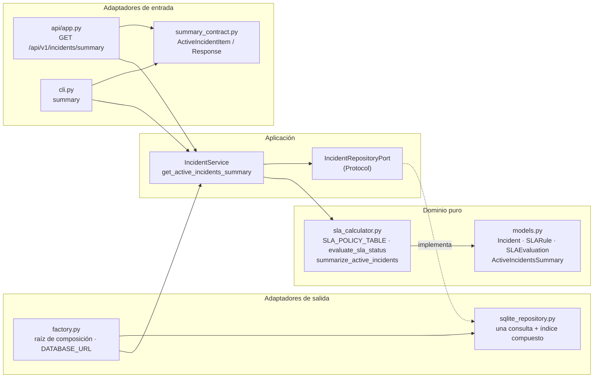

# ADR-005: Resumen de Activos sobre Puerto Único, Dominio y Fábrica de Salida

- **Estado**: Aceptado
- **Fecha**: 2026-11-22
- **Autor(es)**: Equipo de Ingeniería IncidentOps
- **Componentes Afectados**: `src/domain/models.py`, `src/domain/sla_calculator.py`, `src/application/ports.py`, `src/application/services.py`, `src/adapters/outbound/sqlite_repository.py`, `src/adapters/outbound/factory.py`, `src/adapters/inbound/summary_contract.py`, `src/adapters/inbound/api/app.py`, `src/adapters/inbound/cli.py`

---

## 1. Contexto y Problema

H002 debe exponer el resumen de incidentes activos por REST y CLI con totales,
detalle ordenado y filtro opcional por componente. La línea base de la Semana 1
tiene tres problemas que impiden cumplirlo:

1. **Tipos duplicados**: `src/models.py` y `src/sla_calculator.py` definen dos
   versiones de `Incident`, `SLARule` y `SLAEvaluation`, y `IncidentStatus` es
   divergente (una omite `IN_PROGRESS`).
2. **Deuda N+1 intencional**: `IncidentRepository.get_active_incidents_summary`
   hace `SELECT *`, filtra en Python y consulta `sla_policies` una vez por fila.
3. **Dos canales con riesgo de divergencia**: sin un contrato de transporte
   compartido, REST y CLI podrían repetir el orden y los totales.

La decisión estructural es dónde viven el cálculo, la persistencia optimizada y
el ensamblaje, y cómo se garantiza que ambos canales devuelvan el mismo
documento.

---

## 2. Opciones Consideradas

1. **Opción A — Dominio único, puerto explícito y fábrica de salida (Elegida)**:
   - *Ventajas*: el SLA, el orden y los totales viven en `src/domain/`; la
     aplicación solo orquesta; el adaptador SQLite resuelve el filtro con una
     sola sentencia y un índice compuesto; REST y CLI comparten
     `inbound/summary_contract.py` y la fábrica es el único punto que conoce
     clases concretas.
   - *Desventajas*: introduce un puerto, un contrato de transporte y una raíz de
     composición nuevos; exige retirar el legado en el mismo PR y una enmienda
     MINOR de la Constitución (1.1.0).
2. **Opción B — Mantener el legado como fachada del nuevo resumen**:
   - *Ventajas*: menos cambios en el árbol de archivos y en la documentación.
   - *Desventajas*: deja dos puntos de entrada (`python -m src.sla_calculator`,
     `python -m src.incident_repository`) y dos definiciones de los mismos
     tipos, en contradicción con el Principio I y con la unicidad de la
     capacidad.
3. **Opción C — Calcular totales y orden en cada adaptador**:
   - *Ventajas*: no requiere mover reglas al dominio ni compartir contrato.
   - *Desventajas*: duplica el orden por severidad/minutos/identificador en REST
     y CLI y hace que la paridad dependa de dos implementaciones; el orden por
     minutos de SLA no puede delegarse a SQL porque los minutos se calculan en
     el dominio.

---

## 3. Decisión Arquitectónica

Se adopta la **Opción A**. La topología queda:

Reglas estructurales de la decisión:

1. **Un solo puerto**: `IncidentRepositoryPort` con `save_incident`,
   `get_incident`, `find_open_duplicates`, `list_active_incidents` y
   `check_health`, verificado por `isinstance` y por `inspect.signature`.
   `SlaPolicyPort` y `ClockPort` no se declaran: la política es una constante
   del dominio y el instante es un argumento explícito.
2. **El dominio fija el resultado**: `summarize_active_incidents` excluye
   terminales, aborta ante incoherencia temporal, ordena por severidad, minutos
   descendentes e identificador, y calcula ambos totales.
3. **El adaptador no calcula**: `sqlite_repository.py` usa columnas explícitas,
   `INNER JOIN sla_policies`, filtro de estado en SQL y no ordena ni evalúa SLA.
4. **Fábrica única**: `src/adapters/outbound/factory.py` selecciona el
   repositorio por `DATABASE_URL`; `src/composition.py` se retira.
5. **Contrato compartido**: REST y CLI serializan el mismo
   `ActiveIncidentsSummaryResponse`; el CLI no importa `api/`.
6. **Fronteras estáticas**: `src/domain/ruff.toml`, `src/application/ruff.toml`,
   `src/adapters/inbound/ruff.toml` y `src/adapters/inbound/api/ruff.toml`
   extienden la configuración raíz con `TID251`/`TID252`.

### Desviaciones documentadas respecto al borrador de diseño

- **Filtro por componente**: `data-model.md` §3 proponía
  `AND (? IS NULL OR component = ?)`. La verificación con `EXPLAIN QUERY PLAN`
  mostró que esa forma degrada a `SCAN TABLE incidents`; se usan dos variantes
  de la misma consulta (con y sin `component = ?`) para que el filtro resuelva
  por `idx_incidents_component_status`. Sigue siendo una sola sentencia por
  resumen.
- **Cuarto `ruff.toml`**: el paquete `api/` necesita importar sus propios
  módulos (`errors`, `schemas`); como `banned-api` también bloquea submódulos,
  prohibir `src.adapters.inbound.api` en todo `inbound/` marcaría al propio
  adaptador HTTP. La prohibición se mantiene en `src/adapters/inbound/ruff.toml`
  (donde vive el CLI) y `api/ruff.toml` replica solo las prohibiciones del
  legado y del repositorio concreto.
- **`extend` del `ruff.toml` anidado**: la ruta se resuelve desde el archivo de
  configuración, no desde la raíz; `src/adapters/inbound/ruff.toml` usa
  `../../../pyproject.toml` y `api/ruff.toml` usa `../../../../pyproject.toml`.
- **Ejemplo numérico del contrato**: el borrador mostraba `INC-2001` con 46
  minutos y `is_breached: true`, pero un P0 de 46 minutos no supera los 60
  permitidos. Se corrigió el ejemplo a 61 minutos en
  `contracts/summary-api.md` y en el cuadro de siembra de `quickstart.md`; las
  reglas del dominio no cambiaron.

---

## 4. Consecuencias y Trade-offs

- **Positivas**:
  - Una sola fuente para SLA, orden y totales; la paridad REST/CLI se prueba por
    igualdad estricta del documento JSON.
  - El N+1 y el `SELECT *` desaparecen: una sentencia con columnas explícitas e
    índice compuesto para el filtro (verificado en
    `tests/adapters/test_sqlite_repository.py`).
  - El legado retirado no conserva puntos de entrada ni tipos duplicados.
  - `SLA_POLICY_TABLE` es un `MappingProxyType`; el dominio no tiene estado
    global mutable.
- **Negativas / Trade-offs**:
  - Un puerto y una fábrica nuevos que el inbound debe respetar; cualquier
    cambio de fuente de datos pasa por la fábrica.
  - `find_open_duplicates` solo entrega candidatos activos del mismo
    componente; la similitud y la ventana por severidad quedan para H003.
  - Los días festivos siguen sin descontarse (deuda de ADR-002).
- **Verificación**:
  - `tests/domain/test_sla_calculator.py`: fronteras P0 y P2, fin de semana,
    75 %, escalamiento desactivado al incumplir, terminales y coherencia
    temporal.
  - `tests/adapters/test_sqlite_repository.py`: firmas del puerto, una sola
    consulta, uso del índice, migración de `raw_text`, rechazos de entrada,
    lectura sin escrituras y equivalencia con un doble en memoria.
  - `tests/test_spec_002_summary.py`: escenarios BDD de las tres historias y
    paridad HTTP/CLI.

### Evidencia de rendimiento (no sustituye a SC-001)

Medición sobre `Windows`, Python 3.10.2, SQLite en memoria/archivo temporal,
10.000 incidentes activos sembrados y 20 iteraciones:

| Medición | Comando | Resultado |
|---|---|---|
| Resumen filtrado en el adaptador | `uv run python -m src.adapters.outbound.sqlite_repository --records 10000 --iterations 20` | 2.000 activos de `payments-gateway`; promedio **39,18 ms** por resumen |
| Plan de consulta | mismo comando | `SEARCH TABLE incidents AS i USING INDEX idx_incidents_component_status (component=? AND status=?)` |
| HTTP de extremo a extremo | `uv run python tools/benchmark_summary.py --records 10000 --iterations 20` | promedio **58,08 ms** por consulta |
| CLI de extremo a extremo | mismo comando | promedio **77,98 ms** por consulta |

Ambos canales quedan por debajo del objetivo de 1 s de SC-001. El conteo de
consultas (una sola) y el plan de índice son la causa estructural de la mejora;
los tiempos son evidencia de entorno y no una aserción de `pytest`.
