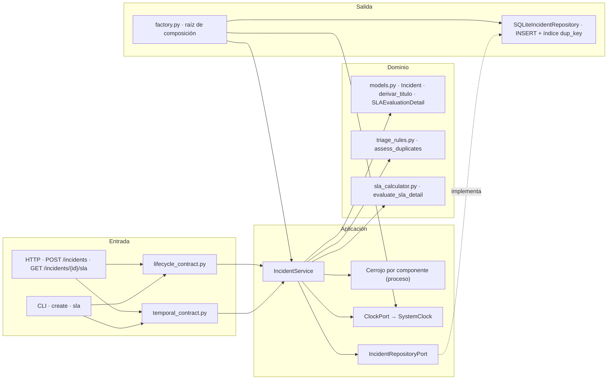

# ADR-006: Ciclo de vida persistente, detección de duplicados y auditoría de SLA

- **Estado**: Aceptado
- **Fecha**: 2026-11-22
- **Autor(es)**: Equipo de Ingeniería IncidentOps
- **Componentes Afectados**: `src/domain/models.py`, `src/domain/triage_rules.py`,
  `src/domain/sla_calculator.py`, `src/application/ports.py`, `src/application/services.py`,
  `src/adapters/inbound/`, `src/adapters/outbound/`

---

## 1. Contexto y Problema

H003 añade dos casos de uso sobre el mismo almacenamiento compartido por HTTP y CLI:

1. **Alta persistente**: clasificar un reporte con el triaje vigente, guardarlo en estado `OPEN` y
   avisar en la misma respuesta si ya existe un incidente equivalente abierto.
2. **Auditoría de SLA**: evaluar un incidente almacenado en un instante de referencia, congelar el
   cómputo en `resolved_at` cuando el incidente es terminal y rechazar referencias incoherentes.

El repositorio de H002 ya exponía `save_incident`, `get_incident` y `find_open_duplicates`, pero
`save_incident` usaba `INSERT OR REPLACE` (sobrescribía en silencio), la detección de equivalencia no
existía y la evaluación de SLA no informaba su contexto temporal. El problema arquitectónico es
decidir **dónde viven las reglas nuevas** y cómo se coordinan la detección y la escritura sin
duplicar políticas en los adaptadores ni introducir un bloqueo distribuido fuera del supuesto de
almacenamiento único.

Restricciones vigentes: dominio puro y determinista (Principio II), fronteras `adapters →
application → domain` (Principio III), puertos explícitos y una única raíz de composición
(Principio IV), sin dependencias nuevas y con paridad estricta entre canales.

---

## 2. Opciones Consideradas

1. **Opción A — Reglas en los adaptadores y transacción SQL**:
   - *Ventajas*: la similitud y la ventana podrían resolverse cerca de los datos; una transacción
     `BEGIN IMMEDIATE` abarcaría detección y alta.
   - *Desventajas*: el adaptador tendría que decidir equivalencia (regla de negocio), `difflib` no se
     puede evaluar en SQL y cualquier adaptador futuro (PostgreSQL) tendría que reimplementar el
     umbral y la ventana. Rompe los Principios I y III.

2. **Opción B — Detección en el dominio y cerrojo por componente en la aplicación (Elegida)**:
   - *Ventajas*: `assess_duplicates`, `is_equivalent`, `derivar_titulo` y
     `evaluate_sla_detail` son funciones puras y auditables; el adaptador solo aporta candidatos
     estructurales y persiste filas. La aplicación serializa la secuencia
     `find_open_duplicates → assess_duplicates → save_incident` por componente.
   - *Desventajas*: el cerrojo es de proceso; no cubre réplicas ni dos procesos sobre el mismo
     archivo (supuesto explícito de la spec).

3. **Opción C — Puerto de bloqueo distribuido (`ComponentLockPort`)**:
   - *Ventajas*: cubriría varios procesos.
   - *Desventajas*: abstracción especulativa con una sola implementación para un requisito que la
     spec acota a un único proceso; añadiría un puerto y una dependencia operativa sin consumidor
     real. Rechazada por el Principio IV.

---

## 3. Decisión Arquitectónica

Se adopta la **Opción B**. Las reglas viven en `src/domain/`; la aplicación orquesta y serializa; los
adaptadores traducen transporte y persistencia.

- **Dominio**:
  - `Incident` gana `recommended_team: Optional[Team]` y `duplicate_group_key: Optional[str]` al
    final del `dataclass`, con valor por defecto para no romper H001/H002.
  - `derivar_titulo(raw_text)` y `MAX_TITULO = 200` viven en `models.py` junto a
    `SLAComputationWindow` y `SLAEvaluationDetail`.
  - `triage_rules.py` publica `DUPLICATE_SIMILARITY_THRESHOLD = 0.75`, `DUPLICATE_WINDOW_DAYS`,
    `DuplicateAssessment`, `is_equivalent` y `assess_duplicates`. La ventana se mide con la
    severidad del más antiguo del par y solo cuentan equivalentes previos.
  - `sla_calculator.py` centraliza `validar_instante_naive`, `resolver_ventana_temporal` y
    `evaluate_sla_detail`, conservando intactas la firma y la aritmética de `evaluate_sla_status`.
- **Aplicación**:
  - `ClockPort.now()` es el único reloj; `SystemClock` lo implementa en el adaptador de salida y
    `factory.py` lo inyecta. Si el servicio no recibe reloj, conserva `datetime.now()`.
  - `IncidentService` mantiene un registro de `threading.Lock` por componente. El cerrojo cubre
    detección y escritura dentro de un proceso y no contiene reglas de negocio.
  - `DataInconsistencyError` gana `status` (409 por defecto) para que la auditoría publique 422 en
    una referencia incoherente sin cambiar el 409 del resumen.
- **Persistencia**:
  - `save_incident` usa `INSERT` estricto y traduce `sqlite3.IntegrityError` a
    `IncidentAlreadyExistsError`. Nunca reemplaza, fusiona ni reasigna.
  - Migración idempotente de `raw_text`, `recommended_team` y `duplicate_group_key` con
    `PRAGMA table_info` + `ALTER TABLE`, antes de crear `idx_incidents_dup_key
    (duplicate_group_key, status)`.
  - La siembra sintética del benchmark conserva su propia sentencia idempotente.
- **Entrada**:
  - `temporal_contract.py` es el único parser ISO 8601 naive; `summary_contract.py` delega en él.
  - `lifecycle_contract.py` define los DTOs de alta y SLA y los mapeos. HTTP los usa como
    `response_model` y la CLI serializa el mismo modelo con `model_dump(mode="json")`, sin importar
    `api/`.
  - El prefijo del código estable se elige por ruta (`TRIAGE`, `SUMMARY`, `CREATE`, `SLA`).

---

## 4. Consecuencias y Trade-offs

- **Positivas**:
  - Una sola fuente de umbral, ventana, clave de grupo, título y SLA; los adaptadores no redeciden
    reglas y un futuro adaptador PostgreSQL hereda la misma semántica.
  - El alta es atómica y no sobrescribe: el conflicto de identificador es explícito (409/salida 1) y
    el aviso de duplicados es informativo.
  - La auditoría distingue la referencia incoherente (422/salida 1) del dato almacenado incoherente
    (409/salida 1) y del incidente inexistente (404/salida 1).
  - HTTP y CLI comparten contrato y serialización, verificados por igualdad estricta de documentos.
- **Negativas / Trade-offs**:
  - El cerrojo por componente es de proceso: dos procesos sobre el mismo archivo no se serializan.
    La clave primaria sigue impidiendo sobrescrituras y la spec acota la garantía a un único proceso.
  - La detección es `O(candidatos del componente × longitud del texto)`; con 10.000 activos y texto
    de hasta 500 caracteres la evidencia de SC-006 es p95 ≈ 21 ms en el alta y ≈ 0,06 ms en la
    auditoría. El índice `idx_incidents_dup_key` no interviene en la decisión de equivalencia; existe
    para consultas por grupo y se verifica con `EXPLAIN QUERY PLAN`.
  - Los festivos siguen sin descontarse (ADR-002) y no se implementa fusión ni reetiquetado de
    duplicados.
- **Verificación**:
  - `tests/test_spec_003_lifecycle_sla.py` (alta, duplicados, SLA, paridad y concurrencia).
  - `tests/domain/test_duplicate_rules.py` y `tests/domain/test_sla_calculator.py`.
  - `tests/application/test_services.py`, `tests/adapters/test_sqlite_repository.py`,
    `tests/adapters/test_api.py` y `tests/adapters/test_cli.py`.
  - `uv run python -m src.adapters.outbound.sqlite_repository --records 10000 --iterations 20`
    imprime el plan de consulta del índice nuevo y el p95 de alta y SLA.
