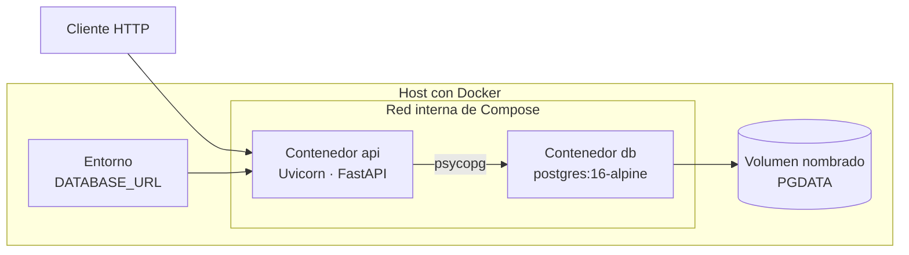

# ADR-008: Runtime multi-contenedor con Docker Compose

- **Estado**: Aceptado
- **Fecha**: 2026-11-23
- **Autor(es)**: Equipo de Ingeniería IncidentOps
- **Reemplaza a**: *(ninguno)*

---

## 1. Contexto y Problema

Hasta H003 el servicio se ejecuta como un proceso local que abre un archivo
SQLite. Ese modelo es cómodo para desarrollar, pero no es reproducible entre
máquinas: la versión de Python, las variables de entorno, la ruta de la base y la
forma de arrancar la API dependen del host. H004 exige un runtime reproducible y
una verificación efectiva de conectividad contra una base de datos dedicada.

Esta decisión es independiente del motor elegido en ADR-004: aquí se fija **cómo
se empaqueta y se ejecuta** la API junto a su base de datos, no qué adaptador de
persistencia se usa. Las restricciones son: un solo host para desarrollo y CI, sin
plataforma de orquestación, con credenciales fuera de la imagen, arranque
ordenado, API sin estado local y una sola réplica mientras el cerrojo por
componente sea de proceso (ADR-006 y ADR-004).

---

## 2. Opciones Consideradas

1. **Opción A — Docker Compose con dos contenedores: `api` y `db`**:
   - *Ventajas*: separa el ciclo de vida de la aplicación y del motor, reproduce
     el entorno con una sola definición, permite un volumen persistente para los
     datos y un healthcheck real de PostgreSQL. La API puede recrearse sin perder
     la base, y el mismo artefacto sirve en local y en CI.
   - *Desventajas*: exige Docker en cada máquina, consume más recursos que un
     proceso único y añade orden de arranque y gestión de secretos. No ofrece alta
     disponibilidad ni orquestación multi-host.

2. **Opción B — Imagen única con la API y PostgreSQL embebido**:
   - *Ventajas*: un solo artefacto y un solo arranque; no hay red entre
     contenedores ni dependencia externa visible.
   - *Desventajas*: mezcla dos ciclos de vida en la misma imagen, ata los datos al
     contenedor y complica las copias y las actualizaciones del motor. Un
     reinicio de la API puede arrastrar la base, y el supervisor interno se
     convierte en un punto único de fallo. Es un antipatrón para un servicio que
     aspira a separar persistencia y aplicación.

3. **Opción C — API nativa contra un PostgreSQL externo o gestionado**:
   - *Ventajas*: no requiere Docker, aprovecha copias, alta disponibilidad y
     parches del proveedor, y separa claramente los equipos de aplicación y de
     datos.
   - *Desventajas*: no es reproducible sin credenciales y conectividad externas;
     el entorno local y la CI dependen de un servicio que no controlan. No cumple
     por sí sola el objetivo de runtime reproducible y añade coste y latencia.

4. **Opción D — Statu quo: proceso local con SQLite**:
   - *Ventajas*: cero infraestructura, arranque inmediato y ninguna credencial que
     gestionar.
   - *Desventajas*: no hay base dedicada ni healthcheck de conectividad, el
     entorno sigue dependiendo del host y no se puede verificar el objetivo de
     H004.

---

## 3. Decisión Arquitectónica

Se adopta la **Opción A**. La topología de referencia queda definida así:

**a) Dos servicios en una red privada.** `api` ejecuta la aplicación (REST y CLI)
y `db` ejecuta `postgres:16-alpine`. La base no se publica al host por defecto;
solo la API la alcanza por la red interna de Compose.

**b) Persistencia separada.** `db` monta un volumen nombrado para `PGDATA`. La API
no monta la base ni conserva estado local: puede recrearse o reemplazarse sin
perder datos. El ciclo de vida del volumen y sus copias son responsabilidad
operativa explícita.

**c) Imagen de API inmutable.** La imagen se construye desde el repositorio y el
lockfile, se ejecuta con un usuario sin privilegios y no contiene credenciales ni
la cadena de conexión. El servidor de aplicación es Uvicorn sobre FastAPI.

**d) Configuración por entorno.** `DATABASE_URL` se inyecta en el arranque de la
API y apunta al servicio `db`. Las credenciales no se versionan ni se hornean en
la imagen; el entorno local las aporta fuera del repositorio.

**e) Arranque ordenado y conectividad verificable.** `db` declara un healthcheck
basado en `pg_isready`; la API espera a que la base esté sana antes de arrancar.
La aplicación expone su propia comprobación de salud apoyada en el puerto de
repositorio y falla de forma explícita si la base no responde, en lugar de
arrancar en un estado degradado silencioso.

**f) Una sola réplica de API.** La topología mantiene una instancia para no romper
el supuesto de cerrojo por componente de ADR-006 y ADR-004. Escalar a varias
réplicas exige un ADR de bloqueo distribuido y una revisión de esta topología.

---

## 4. Consecuencias y Trade-offs

- **Positivas**:
  - El entorno de desarrollo, CI y demostración se reproduce con la misma
    definición y las mismas versiones de Python y PostgreSQL.
  - La aplicación y la base tienen ciclos de vida independientes: recrear la API
    no borra los datos y actualizar el motor no obliga a reconstruir la imagen.
  - El volumen nombrado y el healthcheck hacen explícita la persistencia y la
    conectividad, en lugar de depender de un archivo local.
  - La API sigue siendo stateless y puede reemplazarse sin migrar estado.
  - El DSN por entorno mantiene las credenciales fuera del repositorio y de la
    imagen.
- **Negativas / Trade-offs**:
  - Docker pasa a ser un requisito del flujo de desarrollo y de la CI.
  - El arranque es más lento y consume más recursos que un proceso único.
  - Hay que gestionar el orden de arranque, el volumen, las copias y la limpieza
    de datos de forma deliberada.
  - No se resuelven alta disponibilidad, TLS, orquestación multi-host ni gestión
    centralizada de secretos; esta topología es de un solo host.
  - Una sola réplica limita la capacidad de escalado horizontal mientras el
    cerrojo por componente sea de proceso.
- **Lo que esta decisión no resuelve**: producción distribuida, copias de
  seguridad automáticas, rotación de credenciales, observabilidad centralizada ni
  endurecimiento de la imagen más allá de lo mínimo. Cada uno exige su propio ADR
  o su propio plan operativo.
