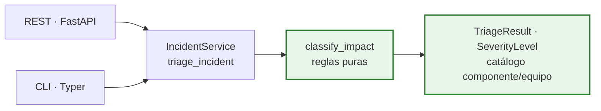

# H001 — Triaje multi-interfaz

- **Estado**: Implementada en H001; pendiente de PR
- **Fecha**: 2026-11-22
- **Ámbito**: Hito 001 de `docs/ROADMAP.md`
- **Precedencia**: Constitución → ADR → esta especificación → código

---

## 1. Objetivo

Exponer el motor de triaje por dos interfaces —HTTP y CLI— sobre un único caso de
uso, de forma determinista y sin persistencia, para que el frontend consuma la
clasificación y soporte pueda probar reportes desde la terminal.

Criterio de cierre (ROADMAP): un mismo reporte produce la misma clasificación y el
mismo enrutamiento en ambas interfaces.

## 2. Alcance

### 2.1 Dentro del alcance

- Un único caso de uso: `IncidentService.triage_incident(incident_id, raw_text)`.
- Adaptador HTTP con FastAPI + Pydantic v2: un endpoint de triaje y uno de salud.
- Adaptador CLI con Typer: subcomando `triage`.
- Migración del motor de triaje a `src/domain/` y retiro de `src/triage_rules.py`
  del árbol ejecutable.
- Arnés de pruebas `pytest` con escenarios BDD en español.

### 2.2 Fuera del alcance

- Persistencia, SQLite y repositorios (H003).
- Detección de duplicados y reglas de ventana de §1.4 (H003). En H001
  `duplicate_group_key` es siempre `null`.
- Triaje por lote, tanto en HTTP como en CLI.
- Registro de incidentes, resumen de activos y reevaluación de SLA (H002/H003).
- Autenticación, autorización y limitación de tasa.
- Adaptador MCP.

## 3. Arquitectura

### 3.1 Capas y archivos

| Ruta | Responsabilidad |
|------|-----------------|
| `src/domain/severity.py` | `SeverityLevel` y catálogo cerrado componente → equipo (§1.5) |
| `src/domain/triage_rules.py` | `TriageResult` y `classify_impact(raw_text)` |
| `src/application/services.py` | `IncidentService.triage_incident` y `ValidationError` con `code` estable |
| `src/adapters/inbound/api/` | `app.py`, `schemas.py`, `errors.py` |
| `src/adapters/inbound/cli.py` | Aplicación Typer con el subcomando `triage` |
| `src/composition.py` | Raíz de composición: construye el servicio |
| `legacy/triage_rules.py` | Copia histórica, no invocable |
| `legacy/README.md` | Advierte que su salida ya no es fuente de verdad |

`src/sla_calculator.py`, `src/incident_repository.py` y el resto de `src/models.py`
permanecen como legado transitorio y no se modifican en este hito.

### 3.2 Regla de dependencia

`adapters → application → domain`. El dominio no importa nada de `src` y no usa
`json`, `datetime`, `pathlib`, `print` ni frameworks.



En H001 el caso de uso no declara puertos de salida: no hay reloj, ni repositorio,
ni política externa que consultar.

## 4. Reglas de dominio aplicables

### 4.1 Severidad por impacto

Precedencia P0 → P1 → P2 → P3; si ninguna regla aplica, el valor por defecto es P2.

| Severidad | Criterio de impacto |
|-----------|---------------------|
| P0 | Indisponibilidad total/global/multi-tenant, pagos caídos, fuga de datos entre organizaciones |
| P1 | Saturación o timeouts de conexiones/pool, degradación severa del servicio |
| P2 | Lentitud medible, cuenta bloqueada, degradación acotada |
| P3 | Cosmética, staging, sin impacto operativo |

La tabla exhaustiva de palabras y componentes vive en `src/domain/` y se cubre con
pruebas de aceptación; esta especificación no la duplica.

### 4.2 Componente y equipo

Catálogo cerrado de §1.5:

| Componente | Equipo |
|------------|--------|
| `payments-gateway` | `Backend-Core` |
| `auth-identity` | `Security-IAM` |
| `database-cluster` | `Data-DBA` |
| `infra-certificates` | `Platform-SRE` |
| `security-audit` | `Security-IAM` |
| `reporting-api` | `otros` |

`otros` es el único valor de reserva.

### 4.3 Invariantes

- Determinismo: misma entrada ⇒ misma salida. Sin reloj, sin aleatoriedad.
- El orden de evaluación de componentes es parte del contrato: un reporte que
  mencione "pagos" y "gateway" se enruta a `payments-gateway`, no a
  `infra-certificates`.
- Las palabras emocionales ("urgente", "hoy", "crítico") no alteran la severidad.
- `rationale` es texto libre en español; el frontend no debe parsearlo.

## 5. Contrato HTTP

### 5.1 Endpoint de triaje

```
POST /api/v1/incidents/triage
Content-Type: application/json
```

```json
{
  "incident_id": "INC-1001",
  "raw_text": "El gateway de pagos devuelve HTTP 502 Bad Gateway en todas las transacciones con tarjeta."
}
```

### 5.2 Respuesta 200 OK

Objeto directo, sin sobre ni `reference_time`.

| Campo | Tipo | Notas |
|-------|------|-------|
| `incident_id` | `string` | Eco del identificador recibido |
| `severity` | `"P0" \| "P1" \| "P2" \| "P3"` | Según §4.1 |
| `component` | `string` | Catálogo de §4.2 |
| `recommended_team` | `string` | Catálogo de §4.2 |
| `rationale` | `string` | Texto libre en español, no contractual |
| `duplicate_group_key` | `null` | Reservado para H003; siempre `null` en H001 |

```json
{
  "incident_id": "INC-1001",
  "severity": "P0",
  "component": "payments-gateway",
  "recommended_team": "Backend-Core",
  "rationale": "Triaje basado en impacto. Componente: payments-gateway, Severidad: P0, Equipo: Backend-Core.",
  "duplicate_group_key": null
}
```

### 5.3 Errores de validación

`422 Unprocessable Entity` con `Content-Type: application/problem+json` (RFC 9457).
El formato por defecto de FastAPI (`{"detail": [...]}`) se reemplaza con un manejador
propio.

```json
{
  "type": "https://incidentops.local/errores/triage-texto-vacio",
  "title": "Texto de reporte vacío",
  "status": 422,
  "detail": "El campo raw_text no puede estar vacío ni contener solo espacios.",
  "code": "TRIAGE_TEXTO_VACIO",
  "errors": [{ "field": "raw_text", "code": "TRIAGE_TEXTO_VACIO" }]
}
```

| `code` | Condición |
|--------|-----------|
| `TRIAGE_ID_VACIO` | `incident_id` vacío o solo espacios tras `.strip()` |
| `TRIAGE_TEXTO_VACIO` | `raw_text` vacío o solo espacios tras `.strip()` |
| `TRIAGE_ID_DEMASIADO_LARGO` | `incident_id` supera 64 caracteres |
| `TRIAGE_TEXTO_DEMASIADO_LARGO` | `raw_text` supera 10 000 caracteres |

### 5.4 Salud

```
GET /health  →  200 {"status": "ok"}
```

### 5.5 Acceso

- Sin autenticación en H001.
- CORS habilitado solo para los orígenes listados en `INCIDENTOPS_CORS_ORIGINS`
  (lista separada por comas). Vacío o ausente ⇒ CORS deshabilitado.
- Sin límite de tasa; queda fuera de alcance.

## 6. Contrato CLI

### 6.1 Invocación

```
uv run python -m src.adapters.inbound.cli triage --incident-id INC-1001 --raw-text "..."
uv run python -m src.adapters.inbound.cli triage --incident-id INC-1001 --raw-text -
uv run python -m src.adapters.inbound.cli triage --file reporte.json
```

### 6.2 Fuentes de texto

Mutuamente excluyentes; exactamente una es obligatoria.

| Forma | Comportamiento |
|-------|----------------|
| `--raw-text "<texto>"` | Texto en línea |
| `--raw-text -` | Lee el reporte completo de `stdin` |
| `--file <ruta>` | Lee un único objeto `{"incident_id", "raw_text"}` en UTF-8 |

Reglas:

- Ninguna fuente o más de una ⇒ código 2.
- `--file` nunca acepta una lista de reportes.
- Si `--file` trae `incident_id` y además se pasa `--incident-id` con un valor
  distinto ⇒ código 2.
- Si `--file` trae `incident_id` y no se pasa el flag, se usa el del archivo.

### 6.3 Salida

- `stdout`: el mismo objeto JSON del contrato HTTP, con `ensure_ascii=False` e
  indentación de 2 espacios.
- `stderr`: `problem+json` con el mismo `code` que HTTP ante entrada inválida.
- No se imprime nada más en `stdout` (sin trazas `[CLASSIFY]` ni `[BATCH]`).

### 6.4 Códigos de salida

| Código | Significado |
|-------:|-------------|
| 0 | Triaje exitoso |
| 2 | Entrada inválida: campo vacío, fuente de texto ausente o redundante, `--file` ilegible |
| 1 | Error inesperado |

## 7. Casos borde

| Caso | Resultado esperado |
|------|--------------------|
| `raw_text = " "` | 422 / código 2, `TRIAGE_TEXTO_VACIO` |
| `incident_id = ""` | 422 / código 2, `TRIAGE_ID_VACIO` |
| `incident_id` con solo tabuladores | 422 / código 2, `TRIAGE_ID_VACIO` |
| `raw_text` de 10 001 caracteres | 422 / código 2, `TRIAGE_TEXTO_DEMASIADO_LARGO` |
| Reporte sin ninguna palabra clave | 200 / 0, `P2`, `reporting-api`, `otros` |
| Texto con "urgente" y "hoy" pero sin impacto | No escala a P0 |
| Texto con "pagos" y "gateway" | `payments-gateway`, `Backend-Core` |
| `--raw-text` y `--file` a la vez | Código 2 |
| `--file` con una lista | Código 2 |
| Acentos y eñes en `--raw-text` | JSON válido con UTF-8 sin escapar |

## 8. Escenarios BDD

### E-01 — Caída crítica HTTP 502 en la pasarela de pagos

**Dado** que el servicio HTTP está disponible y el reporte
`"URGENTE: El gateway de pagos devuelve HTTP 502 Bad Gateway en todas las transacciones con tarjeta de crédito. Ningún comercio puede cobrar."`
con `incident_id = "INC-1001"`,
**Cuando** se envía `POST /api/v1/incidents/triage`,
**Entonces** la respuesta es `200 OK` con `severity = "P0"`,
`component = "payments-gateway"`, `recommended_team = "Backend-Core"` y
`duplicate_group_key = null`.

> **Nota D-01b (resuelta)**: el requerimiento original pedía
> `duplicate_group_key = "payments-gateway:http-502-outage"`. Se descartó porque es
> una clave sintética, no un `incident_id`, y §1.4 exige que la clave sea siempre el
> `incident_id` del original más antiguo; además, H001 no detecta duplicados. El
> campo se mantiene en `null` hasta H003.

### E-02 — Cuenta individual bloqueada que menciona "hoy" no escala a P0

**Dado** que el servicio HTTP está disponible y el reporte
`"He intentado ingresar a mi cuenta tres veces y ahora aparece bloqueada. Necesito acceder hoy mismo para enviar el informe de cierre."`
con `incident_id = "INC-1002"`,
**Cuando** se envía `POST /api/v1/incidents/triage`,
**Entonces** la respuesta es `200 OK` con `severity = "P2"`,
`component = "auth-identity"` y `recommended_team = "Security-IAM"`,
**Y** la severidad no es `"P0"` pese a la palabra "hoy".

### E-03 — Reporte vacío o con solo espacios es rechazado

**Dado** que el servicio HTTP está disponible,
**Cuando** se envía `POST /api/v1/incidents/triage` con `raw_text = " "` e
`incident_id = "INC-1003"`,
**Entonces** la respuesta es `422 Unprocessable Entity` con
`Content-Type: application/problem+json` y `code = "TRIAGE_TEXTO_VACIO"`.

**Dado** que el servicio HTTP está disponible,
**Cuando** se envía `POST /api/v1/incidents/triage` con `incident_id = ""` y un
`raw_text` válido,
**Entonces** la respuesta es `422 Unprocessable Entity` con
`code = "TRIAGE_ID_VACIO"`.

### E-04 — Paridad de la CLI con el caso crítico

**Dado** que el reporte de E-01 se pasa por terminal como
`triage --incident-id INC-1001 --raw-text "URGENTE: El gateway de pagos devuelve HTTP 502 ..."`,
**Cuando** se ejecuta el subcomando `triage`,
**Entonces** el proceso termina con código `0`,
**Y** `stdout` contiene un único objeto JSON válido con `severity = "P0"` y
`recommended_team = "Backend-Core"`,
**Y** ese objeto es idéntico al devuelto por HTTP para el mismo reporte.

### E-05 — CLI con texto desde `stdin`

**Dado** que el reporte de E-02 se escribe en `stdin`,
**Cuando** se ejecuta `triage --incident-id INC-1002 --raw-text -`,
**Entonces** el proceso termina con código `0` y `stdout` contiene
`severity = "P2"` y `recommended_team = "Security-IAM"`.

### E-06 — CLI con archivo de un solo reporte

**Dado** un archivo UTF-8 con `{"incident_id": "INC-1001", "raw_text": "<texto de E-01>"}`,
**Cuando** se ejecuta `triage --file reporte.json`,
**Entonces** el proceso termina con código `0` y la salida coincide con la de E-04.

### E-07 — CLI rechaza entrada vacía

**Dado** que se ejecuta `triage --incident-id INC-1003 --raw-text " "`,
**Cuando** el adaptador valida la entrada,
**Entonces** el proceso termina con código `2`,
**Y** `stdout` está vacío,
**Y** `stderr` contiene `problem+json` con `code = "TRIAGE_TEXTO_VACIO"`.

### E-08 — CLI rechaza fuentes de texto ambiguas

**Dado** que se ejecuta `triage --raw-text "texto" --file reporte.json`,
**Cuando** el adaptador resuelve la fuente de texto,
**Entonces** el proceso termina con código `2` y no se clasifica nada.

## 9. Plan de pruebas

| Nivel | Ubicación | Cobertura |
|-------|-----------|-----------|
| Unitaria de dominio | `tests/domain/` | Tabla table-driven sobre los 10 reportes de `data/sample_incidents.json` y casos de no impacto |
| Aplicación | `tests/application/` | `triage_incident` delega y propaga `ValidationError` |
| Aceptación HTTP | `tests/adapters/test_api.py` | 200, 422 por campo, `code` estable, `/health` |
| Aceptación CLI | `tests/adapters/test_cli.py` | Inline, `stdin`, `--file`, códigos 0/1/2, `stderr` |
| Aceptación BDD y paridad | `tests/test_spec_001_triage.py` | E-01 a E-04 y JSON de HTTP == JSON de CLI para los 10 reportes |

Comando oficial: `uv run pytest`.

Dependencias: `fastapi`, `uvicorn`, `pydantic` v2 y `typer` en runtime; `pytest` y
`httpx` en desarrollo, justificadas en el PR.

## 10. Decisiones registradas

| # | Decisión |
|---|----------|
| D-01 | Operación stateless, sin persistencia |
| D-02 | Un único caso de uso compartido por REST y CLI |
| D-03 | Migración completa a layout hexagonal para el triaje |
| D-04 | `src/triage_rules.py` se archiva en `legacy/`, no invocable |
| D-05 | Solo reporte individual; sin lote en H001 |
| D-06 | `duplicate_group_key` reservado, siempre `null` |
| D-07 | Sin `created_at`, sin `ClockPort`, sin `reference_time` |
| D-08 | Sin `consistency_ratio` en el dominio ni en el transporte |
| D-09 | `rationale` texto libre, no contractual |
| D-10 | Errores RFC 9457 con `code` estable |
| D-11 | CLI en JSON siempre; sin tabla |
| D-12 | Códigos de salida 0/2/1 |

## 11. Puntos resueltos

No quedan puntos abiertos. Las cuatro discrepancias iniciales se cerraron así:

| # | Punto | Estado |
|---|-------|--------|
| D-01b | `duplicate_group_key` en E-01 | Resuelta: `null`. La clave sintética `"payments-gateway:http-502-outage"` se descarta por incompatibilidad con §1.4 |
| D-02b | `incident_id` con formato libre | Resuelta: 1–64 caracteres tras `.strip()`, sin regex; el dominio no impone formato de identificador |
| D-03b | Tope de `raw_text` | Resuelta: 10 000 caracteres, para acotar payload y evitar clasificaciones sobre entradas patológicas |
| D-04b | ADR de interfaces | Resuelta: `docs/adr/004-contrato-interfaces-h001.md` |

## 12. Checklist de PR

- [ ] Dominio sin `json`, `datetime`, `pathlib`, `print` ni frameworks.
- [ ] Sin tipos ni reglas de negocio duplicados fuera de `src/domain/`.
- [ ] REST y CLI comparten `IncidentService.triage_incident`.
- [ ] `uv run pytest` en verde.
- [ ] ADR con diagrama Mermaid y nota de enmienda en ADR-003.
- [ ] `AGENTS.md` sin `python -m src.triage_rules` y con los comandos nuevos.
- [ ] `README.md` actualizado.
- [ ] `CONTEXT_LOG.md` sin reescribir.
- [ ] Rama `diego.betancourt/reto-4`.
