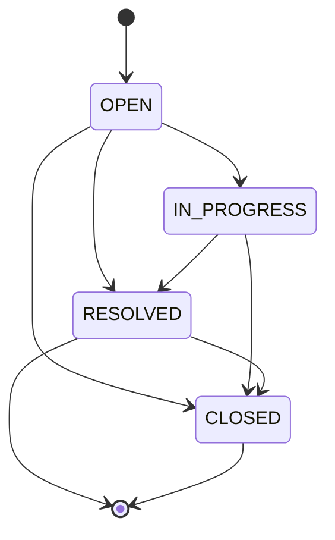

# Modelo de Datos · Resumen de Incidentes Activos (H002)

**Fecha**: 2026-11-22 | **Plan**: [plan.md](./plan.md) | **Spec**: [spec.md](./spec.md)

Este documento fija las entidades de dominio, su forma persistida y las reglas que el resumen aplica. Los nombres de campos del contrato público están en [contracts/summary.schema.json](./contracts/summary.schema.json).

## 1 · Entidades de dominio

Todas son `dataclass(frozen=True)` y se declaran en `src/domain/models.py`; `src/domain/sla_calculator.py` las instancia y produce el resumen, sin redeclararlas.

### `Incident`

| Campo | Tipo | Regla |
|---|---|---|
| `incident_id` | `str` | Identificador único; no vacío |
| `title` | `str` | Texto original, sin truncar |
| `component` | `str` | Componente almacenado; no vacío |
| `severity` | `SeverityLevel` | `P0`, `P1`, `P2`, `P3` |
| `status` | `IncidentStatus` | `OPEN`, `IN_PROGRESS`, `RESOLVED`, `CLOSED` |
| `created_at` | `datetime` | Naive; instante de creación |
| `resolved_at` | `datetime \| None` | Naive; obligatorio para estados terminales |
| `raw_text` | `str \| None` | Reservado para H003 |

`IncidentStatus` es un `Literal` con los cuatro estados; deja de omitir `IN_PROGRESS`.

### `SLARule`

| Campo | Tipo | Regla |
|---|---|---|
| `severity` | `SeverityLevel` | Clave de la tabla |
| `max_resolution_minutes` | `int` | P0 60, P1 240, P2 480, P3 1440 |
| `operates_24x7` | `bool` | P0/P1 verdadero; P2/P3 falso (L-V 08:00-18:00) |
| `escalation_threshold_ratio` | `float` | 0.75 |

La tabla de políticas (`SLA_POLICY_TABLE`) se expone como `Mapping` inmutable (`MappingProxyType`) para cumplir la prohibición de estado global mutable; nada en el dominio la reasigna.

### `SLAEvaluation`

| Campo | Tipo | Regla |
|---|---|---|
| `incident_id` | `str` | Referencia al incidente |
| `severity` | `SeverityLevel` | Severidad evaluada |
| `elapsed_minutes` | `int` | Minutos de SLA truncados |
| `allowed_minutes` | `int` | Máximo de la regla |
| `remaining_minutes` | `int` | `allowed - elapsed` (puede ser negativo) |
| `is_breached` | `bool` | `elapsed > allowed` estricto |
| `requires_escalation` | `bool` | Activo, no incumplido y `elapsed >= int(allowed * 0.75)` |

### `ActiveIncidentsSummary` y `ActiveIncidentDetail`

| Tipo | Campos | Regla |
|---|---|---|
| `ActiveIncidentDetail` | `incident: Incident`, `evaluation: SLAEvaluation` | Un activo con su evaluación |
| `ActiveIncidentsSummary` | `total_active: int`, `breached_count: int`, `incidents: tuple[ActiveIncidentDetail, ...]` | Totales del conjunto consultado |

**Invariantes del resumen**:

1. `total_active == len(incidents)`.
2. `breached_count == sum(1 for d in incidents if d.evaluation.is_breached)`.
3. Todos los `incident.status` pertenecen a `{OPEN, IN_PROGRESS}`.
4. Orden: índice de severidad `P0 < P1 < P2 < P3`; empate por `elapsed_minutes` descendente; empate final por `incident_id` ascendente.
5. `requires_escalation` es falso cuando `is_breached` es verdadero.
6. Un incidente con `created_at > reference_time` aborta la evaluación completa.

## 2 · Máquina de estados



- **Activos**: `OPEN`, `IN_PROGRESS`. Son los únicos que entran al resumen y los únicos que pueden escalar.
- **Terminales**: `RESOLVED`, `CLOSED`. Quedan fuera del resumen aunque su SLA esté vencido; no escalan.

## 3 · Esquema SQLite (adaptador de salida)

```sql
CREATE TABLE IF NOT EXISTS sla_policies (
    severity TEXT PRIMARY KEY,
    max_resolution_minutes INTEGER NOT NULL,
    operates_24x7 INTEGER NOT NULL
);

CREATE TABLE IF NOT EXISTS incidents (
    incident_id TEXT PRIMARY KEY,
    title TEXT NOT NULL,
    component TEXT NOT NULL,
    severity TEXT NOT NULL,
    status TEXT NOT NULL,
    created_at TEXT NOT NULL,          -- ISO 8601 naive
    resolved_at TEXT,                  -- ISO 8601 naive o NULL
    raw_text TEXT
);

CREATE INDEX IF NOT EXISTS idx_incidents_component_status
    ON incidents (component, status);
```

Las políticas se siembran desde `SLA_POLICY_TABLE` del dominio con `INSERT OR REPLACE`; el adaptador nunca redefine umbrales.

**Compatibilidad con bases de Semana 1**: si la tabla `incidents` ya existe sin `raw_text`, el adaptador comprueba `PRAGMA table_info(incidents)` y añade la columna con `ALTER TABLE incidents ADD COLUMN raw_text TEXT`. El índice se crea siempre con `IF NOT EXISTS`, de modo que apuntar `DATABASE_URL` a una base heredada no rompe el arranque.

### Consulta del resumen

```sql
SELECT i.incident_id, i.title, i.component, i.severity,
       i.status, i.created_at, i.resolved_at
FROM incidents AS i
INNER JOIN sla_policies AS p ON p.severity = i.severity
WHERE i.status IN ('OPEN', 'IN_PROGRESS')
  AND (? IS NULL OR i.component = ?)
```

- Una sola sentencia por resumen; sin `SELECT *`, sin filtrado en Python y sin consulta por fila.
- El `INNER JOIN` excluye severidades sin política vigente.
- El índice compuesto cubre el filtro `component` + `status`; la consulta sin filtro recorre los activos.
- El orden final no se delega a SQL: lo fija el dominio para que ambos canales coincidan.

### Mapeo fila → entidad

| Columna | Conversión | Destino |
|---|---|---|
| `incident_id`, `title`, `component`, `status` | directa | `Incident` |
| `severity` | validada contra `SLA_POLICY_TABLE` | `Incident.severity` |
| `created_at` | `datetime.fromisoformat` | `Incident.created_at` |
| `resolved_at` | `fromisoformat` o `None` | `Incident.resolved_at` |

Una fecha con zona horaria en la base es un dato inconsistente: el adaptador la rechaza con un error traducido por la aplicación.

## 4 · Contrato persistido del puerto

| Método | Entrada | Salida | Uso en H002 |
|---|---|---|---|
| `save_incident` | `Incident` | `None` | Sembrado y H003 |
| `get_incident` | `incident_id: str` | `Incident \| None` | Lectura puntual y H003 |
| `find_open_duplicates` | `Incident` | `Sequence[Incident]` | Candidatos activos del mismo componente; H003 completa similitud y ventana |
| `list_active_incidents` | `component_filter: str \| None` | `Sequence[Incident]` | Consulta del resumen |
| `check_health` | — | `bool` | Señal de conectividad (`SELECT 1`) |

`list_active_incidents` no aplica reglas de SLA ni de orden: solo filtra activos y componente. Toda evaluación y orden ocurren en el dominio.

## 5 · Configuración de la fuente

| `DATABASE_URL` | Resultado |
|---|---|
| ausente | `:memory:` (base privada por repositorio) |
| `sqlite:///:memory:` | `:memory:` |
| `sqlite:///ruta/incidentops.db` | archivo relativo o absoluto tras el prefijo |
| otro esquema | error de configuración claro; no se intenta abrir |

La conexión se crea con `check_same_thread=False` y se serializa con un cerrojo; el esquema y el índice se crean de forma idempotente al instanciar el repositorio.

## 6 · Datos de prueba

| Escenario | Datos |
|---|---|
| Global | Activos en varios componentes y severidades, más `RESOLVED` y `CLOSED` con SLA vencido |
| Filtro | Activos en `payments-gateway` y `auth-identity`; consulta por uno de ellos |
| Vacío | Sin incidentes activos, o componente inexistente |
| Fronteras | P0 con 44/45/46 min; P2 con 359/360/361 y 479/480/481 min de SLA |
| Fin de semana | P2 creado viernes 17:00 y consultado lunes 09:00 (120 min) |
| Incoherencia | Incidente activo con `created_at` posterior al instante de referencia |
| Volumen | 10.000 incidentes activos para plan de consulta y benchmark |

No se usan `datetime.now()` ni `sleep` en pruebas de dominio: el instante siempre se inyecta.
