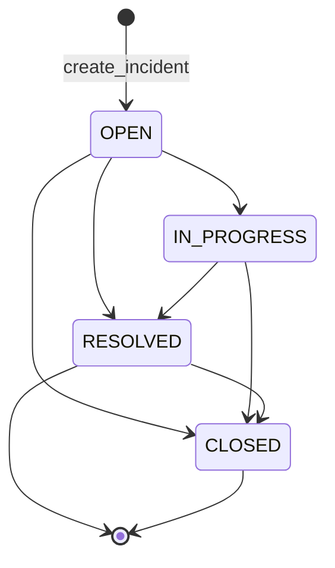

# Modelo de Datos · Ciclo de vida, duplicados y SLA (H003)

**Fecha**: 2026-11-22 | **Plan**: [plan.md](./plan.md) | **Spec**: [spec.md](./spec.md)

Este documento fija las entidades de dominio, su forma persistida y las reglas que el alta y la
auditoría aplican. Los nombres de los campos públicos están en
[contracts/incident-created.schema.json](./contracts/incident-created.schema.json) y
[contracts/sla-evaluation.schema.json](./contracts/sla-evaluation.schema.json).

## 1 · Entidades de dominio

Todas las entidades con campos son `dataclass(frozen=True)` y se declaran en `src/domain/models.py`;
`SLAComputationWindow` es un alias `Literal` del mismo módulo. Ningún adaptador las redeclara. Los
campos nuevos se añaden con valor por defecto para no romper las construcciones existentes de
H001/H002.

### `Incident` (ampliado)

| Campo | Tipo | Regla |
|---|---|---|
| `incident_id` | `str` | Único; se recorta y no puede quedar vacío; máximo 64 caracteres |
| `title` | `str` | Recortado; si se omite se deriva del texto con `derivar_titulo` de `models.py` (primera línea, máximo 200) |
| `component` | `str` | Componente del catálogo cerrado derivado del triaje |
| `severity` | `SeverityLevel` | `P0`, `P1`, `P2`, `P3` |
| `status` | `IncidentStatus` | `OPEN`, `IN_PROGRESS`, `RESOLVED`, `CLOSED` |
| `created_at` | `datetime` | Naive; instante de creación indicado o el de la solicitud |
| `resolved_at` | `datetime \| None` | Naive; obligatorio en estados terminales y posterior o igual a `created_at` |
| `raw_text` | `str \| None` | Texto original sin normalizar; base de la comparación de duplicados |
| `recommended_team` | `Team \| None` | **Nuevo**. Equipo del catálogo cerrado; `None` en filas históricas |
| `duplicate_group_key` | `str \| None` | **Nuevo**. Identificador del original del grupo o clave heredada |

### `SLAComputationWindow` y `SLAEvaluationDetail` (nuevos)

| Tipo | Campos | Regla |
|---|---|---|
| `SLAComputationWindow` | `Literal["24x7", "BUSINESS_HOURS"]` | Derivado de `SLARule.operates_24x7`; no se escribe en la base |
| `SLAEvaluationDetail` | `incident: Incident`, `evaluation: SLAEvaluation`, `reference_time: datetime`, `window: SLAComputationWindow` | Resultado completo de la auditoría; `frozen=True` |

`SLAEvaluation` de H002 no cambia: `incident_id`, `severity`, `elapsed_minutes`, `allowed_minutes`,
`remaining_minutes`, `is_breached`, `requires_escalation`.

### `DuplicateAssessment` (nuevo, en `triage_rules.py`)

| Campo | Tipo | Regla |
|---|---|---|
| `duplicate_group_key` | `str \| None` | Nula si `duplicate_of` está vacío |
| `duplicate_of` | `tuple[str, ...]` | Identificadores de equivalentes **previos**, de más antiguo a más reciente |
| `is_duplicate` | propiedad `bool` | Verdadera si y sólo si `duplicate_of` no está vacío |

### `IncidentCreationResult` (nuevo, en `application/services.py`)

| Campo | Tipo | Regla |
|---|---|---|
| `incident` | `Incident` | Incidente persistido, con `duplicate_group_key` ya resuelta |
| `duplicate` | `DuplicateAssessment` | Veredicto informativo; no altera incidentes previos |

## 2 · Invariantes

**Alta**

1. El estado inicial es siempre `OPEN`; el cliente no impone severidad, componente ni equipo.
2. `incident_id` y `raw_text` son obligatorios, no vacíos y no superan 64 y 10 000 caracteres.
3. El título indicado, si existe, no es vacío y no supera 200 caracteres; si se omite, se deriva de
   forma determinista del texto.
4. `created_at` es opcional; si se omite, el servicio obtiene el instante de `ClockPort` **una sola
   vez** y lo informa en la respuesta.
5. Un identificador ya almacenado se rechaza con conflicto; el incidente previo no se sobrescribe,
   fusiona, reasigna ni modifica.
6. La persistencia es atómica: o se guarda el incidente completo con su clasificación y su clave de
   grupo, o no se guarda nada y no se informa un aviso parcial.
7. El alta nunca se rechaza por duplicados y un aviso de duplicado jamás modifica incidentes
   existentes.

**Duplicados**

8. Sólo se comparan incidentes `OPEN` o `IN_PROGRESS`, del mismo componente, con identificador
   distinto y `raw_text` no vacío.
9. `similarity(new.lower(), candidate.lower()) >= 0.75`; el umbral exacto es equivalente y un valor
   inferior no lo es.
10. La diferencia temporal se mide del más antiguo al más reciente del par y debe cumplir
    `0 <= delta <= ventana(severidad_del_más_antiguo)`; el límite exacto es candidato.
11. `duplicate_of` contiene únicamente equivalentes que **preceden** al nuevo en el orden canónico
    `(created_at, incident_id)` ascendente, ordenados de la misma forma.
12. `duplicate_group_key` es `None` si no hay previos; si hay, es `original.duplicate_group_key or
    original.incident_id` del más antiguo. Nunca es el identificador de un duplicado intermedio.
13. Si el nuevo registro es el más antiguo del conjunto equivalente, actúa como original: no recibe
    clave, `is_duplicate=false`, `duplicate_of=[]`, y no se reescriben los incidentes posteriores.

**SLA**

14. `reference_time` es opcional; si se omite, el servicio obtiene el instante de `ClockPort` una sola
    vez y lo informa.
15. `reference_time >= created_at` siempre; en caso contrario la consulta se rechaza completa.
16. En terminales, `resolved_at` existe, es posterior o igual a `created_at` y el cómputo termina
    ahí, con independencia de que `reference_time` sea anterior o posterior a la resolución.
17. `elapsed_minutes` se trunca a minutos enteros; `remaining_minutes = allowed - elapsed` (puede ser
    negativo); `is_breached = elapsed > allowed`; `requires_escalation = activo ∧ ¬breached ∧
    elapsed >= int(allowed * 0.75)`.
18. `window` se deriva de la regla: `24x7` para P0/P1 y `BUSINESS_HOURS` para P2/P3. Los festivos
    siguen sin descontarse (ADR-002).
19. La auditoría es de sólo lectura: no modifica el incidente, su estado, su clave de grupo ni
    ningún otro dato.
20. Severidad o estado desconocidos en el almacenamiento, o `resolved_at < created_at`, son
    incoherencia de datos: se rechaza la consulta sin inventar valores por defecto.

**Temporales (transversal)**

21. `created_at`, `resolved_at` y `reference_time` deben ser naive. Un valor con zona horaria se
    rechaza; no se convierte a UTC.

## 3 · Estados y transiciones



H003 sólo crea el estado inicial `OPEN`; resolver, cerrar o reabrir queda fuera de alcance. La
auditoría de SLA sí evalúa terminales ya almacenados.

## 4 · Algoritmo de duplicados

```text
assess_duplicates(nuevo, candidatos):
    clave_nuevo = (nuevo.created_at, nuevo.incident_id)
    previos = []
    para cada candidato en candidatos:
        si candidato.status no está activo: continuar
        si candidato.component != nuevo.component: continuar
        si candidato.incident_id == nuevo.incident_id: continuar
        si candidate.raw_text está vacío o es None: continuar
        clave_candidato = (candidato.created_at, candidato.incident_id)
        si clave_candidato >= clave_nuevo: continuar        # sólo previos
        (antiguo, reciente) = ordenar_por_clave(candidato, nuevo)
        ventana = DUPLICATE_WINDOW_DAYS[antiguo.severity]
        delta = reciente.created_at - antiguo.created_at
        si not (0 <= delta <= timedelta(days=ventana)): continuar
        si SequenceMatcher(None, nuevo.raw_text.lower(), candidato.raw_text.lower()).ratio() < 0.75:
            continuar
        previos.append(candidato)
    previos.sort(key=lambda c: (c.created_at, c.incident_id))
    si not previos:
        return DuplicateAssessment(None, ())
    original = previos[0]
    return DuplicateAssessment(original.duplicate_group_key or original.incident_id,
                               tuple(c.incident_id for c in previos))
```

La ventana se calcula con la severidad del más antiguo del par; el resultado es determinista y no
depende del orden de entrada de los candidatos porque la lista final se ordena.

## 5 · Esquema SQLite (adaptador de salida)

```sql
CREATE TABLE IF NOT EXISTS incidents (
    incident_id TEXT PRIMARY KEY,
    title TEXT NOT NULL,
    component TEXT NOT NULL,
    severity TEXT NOT NULL,
    status TEXT NOT NULL,
    created_at TEXT NOT NULL,          -- ISO 8601 naive
    resolved_at TEXT,                  -- ISO 8601 naive o NULL
    raw_text TEXT,
    recommended_team TEXT,             -- NUEVO
    duplicate_group_key TEXT           -- NUEVO
);

CREATE INDEX IF NOT EXISTS idx_incidents_component_status
    ON incidents (component, status);

CREATE INDEX IF NOT EXISTS idx_incidents_dup_key
    ON incidents (duplicate_group_key, status);
```

**Migración idempotente**: `_init_schema` lee `PRAGMA table_info(incidents)` y ejecuta
`ALTER TABLE incidents ADD COLUMN ...` para `raw_text`, `recommended_team` y `duplicate_group_key`
cuando faltan. Los índices se crean con `IF NOT EXISTS`. Apuntar `DATABASE_URL` a una base de H002 o
de la Semana 1 no rompe el arranque.

**Escritura del alta**

```sql
INSERT INTO incidents
    (incident_id, title, component, severity, status, created_at, resolved_at,
     raw_text, recommended_team, duplicate_group_key)
VALUES (?, ?, ?, ?, ?, ?, ?, ?, ?, ?);
```

- Un fallo de clave primaria se traduce a `IncidentAlreadyExistsError` (409 / salida 1); nunca hay
  `REPLACE`.
- La siembra sintética del benchmark usa una sentencia propia e idempotente; no es la ruta de alta.

**Lecturas**

```sql
-- get_incident
SELECT i.incident_id, i.title, i.component, i.severity, i.status,
       i.created_at, i.resolved_at, i.raw_text,
       i.recommended_team, i.duplicate_group_key
FROM incidents AS i
WHERE i.incident_id = ?;

-- find_open_duplicates (filtro estructural; la equivalencia es del dominio)
SELECT <mismas columnas>
FROM incidents AS i
INNER JOIN sla_policies AS p ON p.severity = i.severity
WHERE i.status IN ('OPEN', 'IN_PROGRESS')
  AND i.component = ?
  AND i.incident_id <> ?;
```

`find_open_duplicates` no aplica similitud ni ventana: son reglas del dominio. `get_incident` no
filtra por estado, porque la auditoría evalúa activos y terminales.

## 6 · Mapeo fila → entidad

| Columna | Conversión | Destino |
|---|---|---|
| `incident_id`, `title`, `component`, `status` | directa, con validación de estado | `Incident` |
| `severity` | validada contra `SLA_POLICY_TABLE` | `Incident.severity` |
| `created_at`, `resolved_at` | `datetime.fromisoformat`; aware se rechaza | `Incident.created_at` / `resolved_at` |
| `raw_text` | directa o `None` | `Incident.raw_text` |
| `recommended_team` | directa o `None`; si no es nula, debe pertenecer al catálogo | `Incident.recommended_team` |
| `duplicate_group_key` | directa o `None` | `Incident.duplicate_group_key` |

Un valor fuera del catálogo de equipos, una severidad sin política, un estado desconocido o una fecha
con zona son datos incoherentes: el adaptador lanza `InvalidIncidentError` y el caso de uso lo
traduce al código estable correspondiente.

## 7 · Contrato persistido del puerto

| Método | Entrada | Salida | Uso en H003 |
|---|---|---|---|
| `save_incident` | `Incident` | `None`; `IncidentAlreadyExistsError` si el id existe | Alta persistente |
| `get_incident` | `incident_id: str` | `Incident \| None` | Auditoría de SLA |
| `find_open_duplicates` | `Incident` | `Sequence[Incident]` | Candidatos estructurales para el dominio |
| `list_active_incidents` | `component_filter: str \| None` | `Sequence[Incident]` | Resumen de H002, sin cambios |
| `check_health` | — | `bool` | Señal de conectividad |

La firma no cambia respecto de H002; sólo se precisa la semántica de escritura. `IncidentService`
mantiene el cerrojo por componente que serializa detección y alta dentro de un único proceso.

El reloj es un puerto secundario: `ClockPort` en `src/application/ports.py` expone `now() -> datetime`,
`SystemClock` lo implementa en `src/adapters/outbound/system_clock.py` y `factory.py` lo inyecta como
única raíz de composición. Si el servicio no recibe reloj, conserva el `datetime.now()` de H002. El
dominio sigue sin reloj propio.

## 8 · Configuración de la fuente

| `DATABASE_URL` | Resultado |
|---|---|
| ausente | `:memory:` (base privada por repositorio) |
| `sqlite:///:memory:` | `:memory:` |
| `sqlite:///ruta/incidentops.db` | archivo relativo o absoluto tras el prefijo |
| otro esquema | error de configuración claro; no se intenta abrir |

La conexión se crea con `check_same_thread=False` y se serializa con un cerrojo del adaptador; el
esquema, la migración y los índices se aplican de forma idempotente al instanciar el repositorio.

## 9 · Datos de prueba

| Escenario | Datos |
|---|---|
| Alta simple | Reporte de `payments-gateway` sin candidatos; `created_at` explícito |
| Duplicado simple | Original activo y nuevo con texto equivalente, mismo componente y dentro de la ventana |
| Falsos positivos | Candidato terminal, otro componente, similitud 0,74, delta de un segundo por encima de la ventana, candidato sin `raw_text` |
| Grupo heredado | Original con clave propia y duplicado intermedio; el nuevo hereda la clave del original |
| Original más antiguo | Nuevo con `created_at` anterior a todos los equivalentes; no recibe clave |
| SLA activo | P0 en 60/61 min; P1 con 180 min; P2 viernes 17:00 → lunes 09:00 |
| SLA terminal | `RESOLVED` con `resolved_at` y referencias antes y después de la resolución |
| Incoherencias | `reference_time < created_at`; `resolved_at < created_at`; fecha aware |
| Concurrencia | Dos hilos con barrera, mismo componente y textos equivalentes; el `created_at` del segundo es posterior (o su identificador es canónicamente mayor a igual instante) para que el aviso sea determinista |
| Volumen | 10.000 activos para medir alta, SLA y plan de consulta; el alta de la medición usa un texto de hasta 500 caracteres y se ejecuta de forma secuencial (SC-006) |

No se usan `datetime.now()` ni `sleep` en las pruebas de dominio: el instante y el reloj se inyectan.
